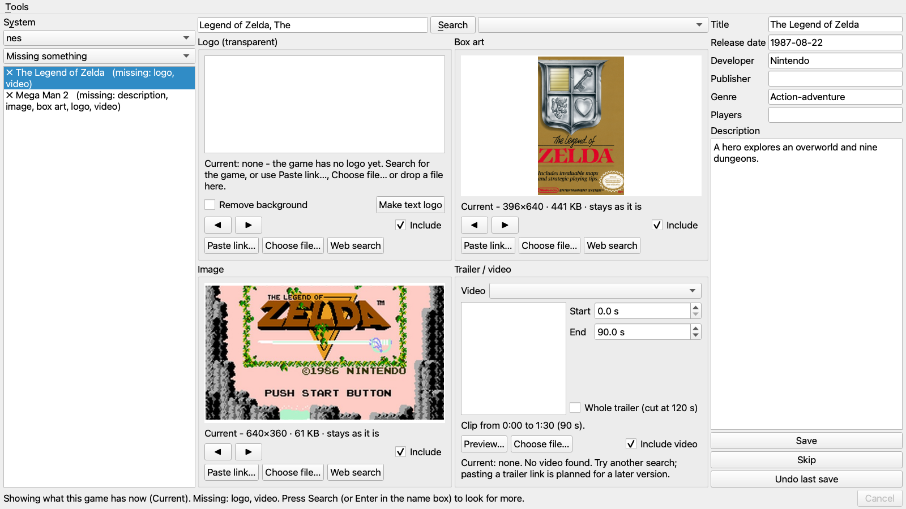
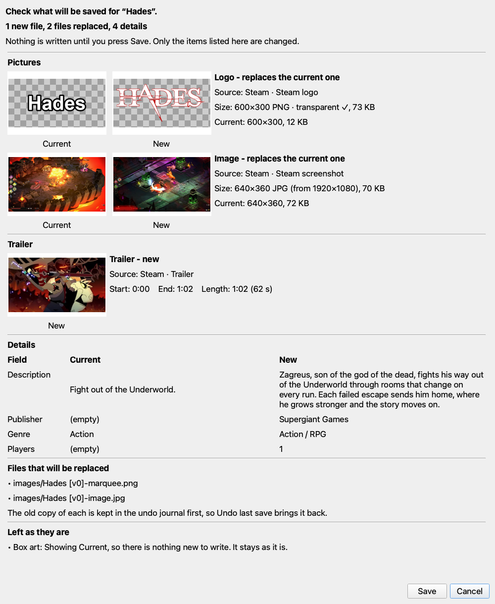
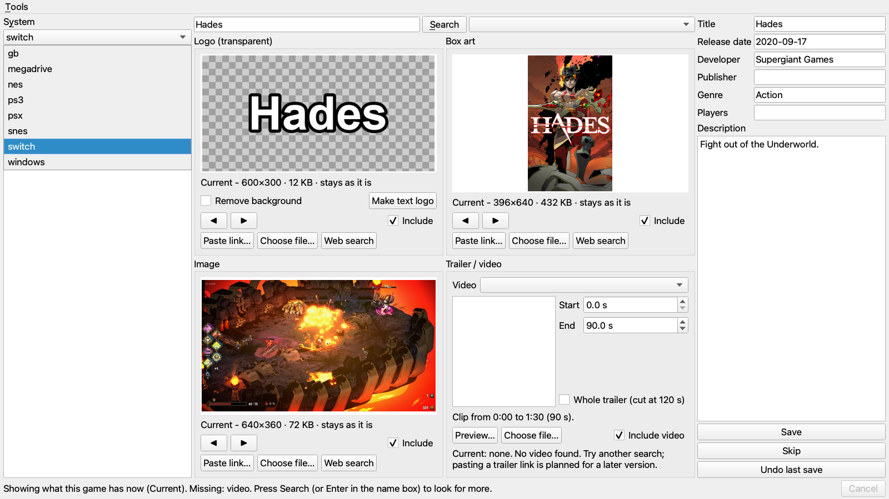
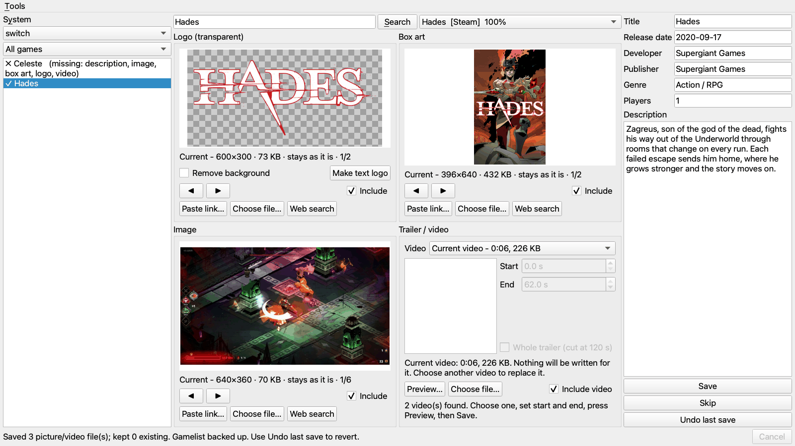
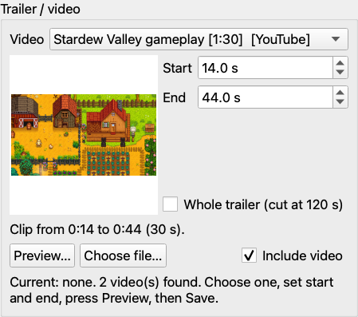
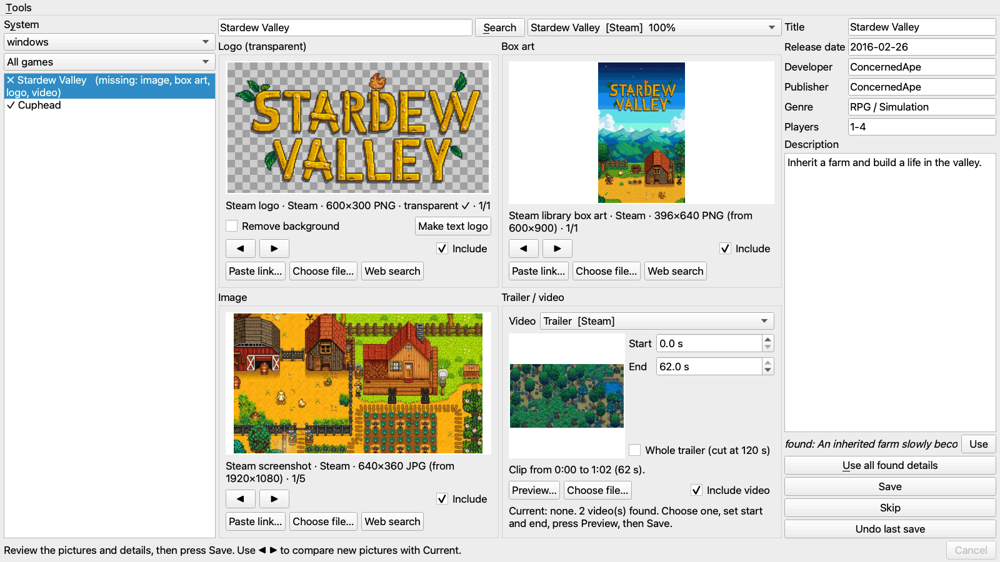
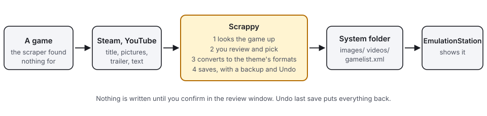

<div align="center">

<picture>
  <source media="(prefers-color-scheme: dark)" srcset="assets/logo-dark.svg">
  
</picture>

# Scrappy

**Fills in the artwork, trailers and descriptions your scraper missed.**
A desktop utility for Batocera: it finds a game's logo, box art, picture, trailer and description, lets you check them, and writes them where EmulationStation looks.

<!-- ⚠️ All badges in a group must sit on ONE source line. GitHub renders a single newline as <br>, so
     one badge per line stacks them vertically instead of flowing them inline. -->

[](https://github.com/eknowledger/scrappy/actions/workflows/tests.yml) [](https://github.com/eknowledger/scrappy/actions/workflows/build.yml) [](LICENSE)

[](docs/ARCHITECTURE.md#12-packaging-deployment-and-ci) [](COMPATIBILITY.md) [](COMPATIBILITY.md)

</div>

<p align="center"></p>

<p align="center"><a href="https://youtu.be/ZLmj5S1XHdE"></a><br><sub>90 second demo on YouTube (a real search; the waiting is sped up).</sub></p>

Batocera's built-in scraper finds nothing for many newer games, so they sit in the list without a logo, a picture, a trailer or a
description. Scrappy looks the game up on Steam and YouTube, shows you what it found next to what the game has now, converts what you
choose to the sizes and formats the theme plays, and writes it into the system's `images/` and `videos/` folders and its `gamelist.xml`,
with a backup and an **Undo**. It runs on the Batocera desktop, with a mouse and keyboard.

> **Not affiliated with any game, company or console shown.** The screenshots show real games and their artwork, which belong to their
> owners. See [Trademarks and artwork](#license). This is an independent, unofficial project.

## Contents

- [What it does](#what-it-does)
- [Why](#why)
- [How it works, in plain words](#how-it-works-in-plain-words)
- [Status and compatibility](#status-and-compatibility)
- [Install on Batocera](#install-on-batocera)
- [Using it](#using-it)
- [Safety](#safety)
- [What it contacts](#what-it-contacts)
- [Demo mode, and the screenshots](#demo-mode-and-the-screenshots)
- [Tests](#tests)
- [Documentation](#documentation)
- [Credits](#credits)
- [License](#license)

## What it does

Pick a system and a game. The panels show what the game has now ("Current"), and the list tells you what is missing:

<p align="center"></p>

Press **Search**. Steam and YouTube are asked at the same time. You get candidates for the logo, box art, image and trailer, and the
details (title, description, release date, developer, publisher, genre, players), each compared with what is there now. Step through
the candidates with the arrow buttons, tick what to include, or use a file or a link of your own.

Press **Save**. Nothing is written yet: a review window lists exactly what would be, every new picture next to the current one, every
changed detail old and new, and the files that would be replaced or left alone.

<p align="center"></p>

Only on **Save** in that window are the files converted and written. **Undo last save** puts everything back.

<details>
<summary>More pictures of the window</summary>

| | |
|---|---|
| <br>A partly finished game: the pictures it already has are shown as **Current**. | <br>After a save: the panels show what was saved as the new Current. |
| <br>The trailer panel: choose the part to keep (up to 120 seconds by default). | <br>A search result: logo, box art, image and trailer found, with the details beside them. |

</details>

## Why

The scrapers that come with Batocera depend on a database that knows the game. For a game released last month, or a PC game with no
console release, it often finds nothing, and doing it by hand means an image search, a YouTube search, converting the pictures and the
video to the right sizes, copying files into the right folders and editing XML. Scrappy does those steps, and shows its work before it
writes anything. It is built for the gaps the scraper leaves, one game at a time, not to scrape a whole library.

## How it works, in plain words

<picture>
  <source media="(prefers-color-scheme: dark)" srcset="assets/how-it-works-dark.svg">
  
</picture>

1. **Look up.** From the ROM's file name it makes a clean title (`Tidepool Tactics [0100AAAA00000000][v0].nsp` becomes `Tidepool Tactics`),
   asks Steam for matching games and YouTube for trailers, and lets you pick the right match.
2. **Review.** Each slot (logo, box art, image, trailer) shows the game's current file first, then the candidates. Pictures are already
   converted in the panel, so what you see is what will be saved.
3. **Convert.** Image 640x360 JPEG, box art 396x640 PNG, logo 600x300 transparent PNG, trailer MP4 H.264 1280x720 at 30 fps with sound,
   cut to the start and end you set. These sizes are fixed in the program; it does not read your theme.
4. **Save.** Files are written atomically, `gamelist.xml` is edited only in the tags it was asked to change, the previous `gamelist.xml`
   is backed up, and every step is journaled so a failure rolls back and **Undo** can reverse it. If EmulationStation is running, Scrappy asks it to
   flush its game lists first and reload them after, and checks that its own change survived, because EmulationStation keeps its own copy.

## Status and compatibility

Version 0.1.0, alpha. **Verified:** Batocera v41 on x86_64. The installer's aarch64 path is tested in a virtual machine.
**Not verified:** RetroBat and other EmulationStation based systems, other themes, ARM boards (see [COMPATIBILITY.md](COMPATIBILITY.md),
which also tells you how to report your setup). Today's sources are Steam and YouTube, built into the program, so games Steam does not sell
(most older console games) find nothing and you supply the pictures and the trailer yourself. A plan for more sources and for provider plugins is in
[docs/PROVIDERS.md](docs/PROVIDERS.md); it is not implemented yet. More in [docs/KNOWN-LIMITATIONS.md](docs/KNOWN-LIMITATIONS.md); what might come is in [ROADMAP.md](ROADMAP.md).

## Install on Batocera

You install from another computer (a Mac or a Linux machine) over `ssh`, with key-based login to the Batocera (the installer does not ask for a
password). That computer needs `bash`, `ssh`, `tar` and `curl` or Python 3, and internet access once, for the Pillow file. The Batocera: v41 (Python 3.11,
PyQt5 and ffmpeg, as it ships), **x86_64 or aarch64**, and at least 200 MB free in `/userdata`.

```sh
git clone https://github.com/eknowledger/scrappy.git
cd scrappy
deploy/install.sh --dry-run     # shows every step and every command it would send; nothing is changed on the Batocera
deploy/install.sh               # installs to root@batocera.local (or: deploy/install.sh root@192.168.1.100)
```

Then start **Scrappy** from the Applications menu (F1) or the icon on the Desktop. To remove it: `deploy/install.sh --uninstall` (keeps your
backups, journal and settings; `--uninstall --purge --yes` removes those too).

**What the installer does and checks**, in order:

1. Asks the machine for its architecture (`uname -m`, read-only). x86_64 and aarch64 are accepted; anything else is refused before anything is
   built or sent. A `--dry-run` makes no connection to the Batocera, so it assumes x86_64 (or `SCRAPPY_ARCH`) and says so.
2. Fetches the pinned **Pillow** wheel for that architecture from `files.pythonhosted.org` into `~/.cache/scrappy/wheels` and refuses it unless
   its sha256 equals the pin in `deploy/vendor.txt`. Batocera's own Pillow cannot read or write JPEG, so a working one is shipped with the program.
   (A dry run does this too, if the wheel is not cached yet.)
3. Builds one tarball of the program with a checksum manifest, and refuses to continue if the Batocera has less than 200 MB free.
4. Uploads it, compares its sha256, unpacks it into a **new staging folder**, checks the manifest, compiles every file on the box's Python,
   imports the program from the staged copy, unpacks the wheel with validated file names and runs a **real JPEG round trip** with it. The installed
   version is still untouched at this point.
5. Swaps the new version in by renaming (the old one is kept as `scrappy.previous`, and put back if anything fails), installs the shortcuts, verifies
   the result and runs a read-only probe.

It writes only under `/userdata/system/scrappy`, the shortcuts and `/userdata/system/logs/scrappy.log`, and never touches `config.json`, `backups/`,
`journal/`, `cache/`, `bin/` or `logs/` when it updates. Updating is the same command. An install made by a pre-release version is migrated automatically; see
[docs/USAGE.md](docs/USAGE.md#update-reinstall-uninstall).

## Using it

<p align="center"></p>

A walk through one game, here *Orbit Otters* on the `megadrive` system (the numbers are explained in the
[window tour](docs/USAGE.md#window-tour)):

1. Choose the system, and set the filter to **Missing something**. Click the game. Each panel shows what it has now, or "Current: none".
2. Check the title in the name box (fix it if the file name confuses it) and press **Search**. Pick the right match in the box next to it.
3. Look at each panel. The first entry is **Current**; use the arrow buttons for the candidates. Tick **Remove background** for a logo on a plain
   background, or press **Make text logo**. Choose the trailer, and set its start and end. **Preview...** plays it in an external player (mpv, vlc or ffplay).
4. Edit the details on the right, or press **Use** beside a "found:" line to take a value Steam gave. A box that already has text is never overwritten
   by a search.
5. Press **Save**, read the review window, press **Save** again. The status line says what was written.
6. Reload the game lists (**Tools > Reload game lists in EmulationStation**, or the **Reload game lists** button beside the status line) if
   the status line does not say it was done; a window shows how it went. Press **Undo last save** if you do not like the result.

The YouTube downloader (the small helper that finds YouTube trailers) is installed from the **Tools** menu at the top left, or with the
**Install YouTube downloader** button in the Trailer panel. A window shows the download with a progress bar and says at the end whether it worked.

The guide, [docs/USAGE.md](docs/USAGE.md), has a quick start, an annotated tour of every control, one short section per task (replace only
the box art, use a picture of your own, undo, clean up a whole system), and tables for settings, files, shortcuts, troubleshooting and logs.

## Safety

- **Nothing is written until you confirm in the review window.** Looking, searching and previewing write nothing to your library.
- **Backup and Undo.** Every save keeps a copy of the previous `gamelist.xml` (the very first one of each system forever, plus the newest 30)
  and a journal of the last 20 saves, including a copy of every file it replaced. **Undo last save** restores them, also after a restart, and
  refuses to throw away changes someone else made since unless you say so.
- **Your art is kept.** A slot is replaced only when you picked a new picture for it. A zero-byte file counts as missing.
- **Atomic writes.** Every file is written to a temporary file, synced and renamed, so a crash leaves the old file or the new one. A failure rolls
  everything back; a damaged `gamelist.xml` is never overwritten. Only the seven text tags (title, description, release date, developer,
  publisher, genre, players) and the four media tags are ever written; a blank never clears a field.
- **Downloads only from public hosts.** Pictures come through a downloader that refuses addresses on your own network, caps size, time and
  redirects, and decodes only common picture formats.
- **Nothing outside the system's folders.** Media are written only inside the system folder (a symbolic link that leads elsewhere is refused), and the program deletes
  only files it made.
- **No telemetry, no account, no automatic update.** It opens no network port.

[SECURITY.md](SECURITY.md) has the threat model, everything it executes (ffmpeg, mpv, yt-dlp, a browser), what the installer does as root on the box,
and how to turn parts off. Report a vulnerability privately there.

## What it contacts

Every host the program, the installer or a tool talks to. Your IP address is visible to each of them; none of it needs an account, a cookie or a key.

| Host | Why | When | What is sent |
|---|---|---|---|
| `store.steampowered.com` | game search and details | you press Search or pick a match | the title you typed, the store country `us` and language `en`, a Steam app id; `User-Agent: Mozilla/5.0 (Scrappy)` |
| `api.steampowered.com` | addresses of the library art | a match is loaded (a DLC also asks for its base game) | a Steam app id |
| `*.steamstatic.com`, `*.akamaihd.net` (https only) | pictures, `logo.png` (a `HEAD`), trailer streams | a candidate is shown; Preview or Save for a trailer (ffmpeg and your player fetch it) | a plain `GET`; picture downloads send `User-Agent: Mozilla/5.0 (compatible; Scrappy/0.1; personal Batocera game-art tool)`; ffmpeg and the player send their own |
| `www.youtube.com` and whatever hosts YouTube hands yt-dlp (typically `*.googlevideo.com`), via **yt-dlp** | trailer search and download | you press Search (only if yt-dlp is installed); Save with a YouTube trailer | the search text `<title> <platform hint> official trailer`; yt-dlp's own requests, with no cookies |
| `i.ytimg.com` (`*.ytimg.com`, https only) | thumbnails of YouTube results | the results are shown | a plain `GET` |
| `github.com` (may redirect to `*.githubusercontent.com`) | the yt-dlp program | **only** when you choose Tools > Install / update YouTube downloader or press Install YouTube downloader | a `GET` of the latest release, `User-Agent: Mozilla/5.0` |
| any public web address you paste or drop on a picture panel | that picture | you paste or drop it | a plain `GET`; addresses that resolve to your own network are refused |
| `127.0.0.1:1234` (EmulationStation, on the same machine) | reload its game lists | a save or undo while it runs; the Tools menu entry or the Reload game lists button | `GET /reloadgames`, never through a proxy. The environment probe reads `/` and `/runningGame` |
| *your browser* → `duckduckgo.com` | the Web search button | you press it | Scrappy only opens your browser at an image search for the title; it does not contact DuckDuckGo itself |
| the Batocera, over `ssh` | the installer | you run `deploy/install.sh` (not `--dry-run`) | the program and the commands in `deploy/install.sh`, which `--dry-run` prints |
| `files.pythonhosted.org` | the pinned Pillow wheel | `deploy/install.sh`, on the computer you install from, if it is not cached (also in a dry run) | a plain `GET` of the URL in `deploy/vendor.txt` |
| Steam, YouTube, `api.github.com`, `raw.githubusercontent.com` | developer tools only | you run `tools/fetch_demo_art.py` or `tools/capture_fixtures.py`, or `tools/box_selftest.py --network` / `--youtube` | ordinary requests; each tool's header says what it asks for and its limits |

yt-dlp is **not** updated by itself: it is fetched only when you ask, and without it the YouTube part does nothing. The demo mode contacts nothing.

## Demo mode, and the screenshots

`python -m scrappy.app --demo` opens the real window on a fictional library of 15 invented games on five retro systems, with invented sources and
short generated trailers. Nothing real is read or written. On the Batocera: `ssh root@batocera.local /userdata/system/scrappy/scrappy.sh --demo`.
It is how to try the program without risk, and what the tests drive.

The pictures in `docs/screenshots/` are the real window, made without a display:

```sh
.venv/bin/pip install -r requirements-dev.txt PyQt5
.venv/bin/python tools/make_screenshots.py --out /tmp/shots        # the invented library, works offline
.venv/bin/python tools/make_screenshots.py --real                  # real games; needs the artwork cache (CONTRIBUTING.md, Screenshots)
.venv/bin/python tools/make_annotated_screenshots.py --out /tmp/ann  # the numbered pictures of docs/USAGE.md (invented library only)
```

The real artwork is fetched into a cache folder outside the repository and is never committed.

## Tests

```sh
python3 -m venv .venv
.venv/bin/pip install -r requirements-dev.txt PyQt5
.venv/bin/python -m pytest
```

About 1500 tests, in four to five minutes, with Steam, YouTube, ffmpeg, EmulationStation, `ssh` and `/userdata` faked and the window run offscreen.
They cover the saver (rollback, undo, crashes), the downloader, both sources against captured answers, the picture and trailer conversion, the
window, and the installer, whose real remote scripts run against a fake `ssh` and a sandboxed `/userdata`. They do not show how the window looks
on the Batocera's screen or what a given theme draws; [COMPATIBILITY.md](COMPATIBILITY.md) is the record of that.

## Documentation

- [docs/USAGE.md](docs/USAGE.md): the user guide, with annotated screenshots: quick start, window tour, tasks, settings, troubleshooting, logs, update and uninstall.
- [docs/ARCHITECTURE.md](docs/ARCHITECTURE.md): how it is put together and why; read before changing the code.
- [docs/PROVIDERS.md](docs/PROVIDERS.md): the provider contract in the code, how to write a provider, and the plan for more sources and plugins.
- [docs/KNOWN-LIMITATIONS.md](docs/KNOWN-LIMITATIONS.md): what it does not do and the risks that were accepted.
- [COMPATIBILITY.md](COMPATIBILITY.md): what is verified, what is only tested, what is not, and how to report your setup.
- [SECURITY.md](SECURITY.md): threat model, what it downloads, runs and writes, how to report a vulnerability.
- [CHANGELOG.md](CHANGELOG.md), [ROADMAP.md](ROADMAP.md), [CONTRIBUTING.md](CONTRIBUTING.md).
- [docs/screenshots/README.md](docs/screenshots/README.md): where each screenshot comes from.

## Credits

Scrappy is a small program on top of other people's work.

- [Steam](https://store.steampowered.com), whose public store pages and library art are the main source of text and pictures.
- [yt-dlp](https://github.com/yt-dlp/yt-dlp), for finding and downloading YouTube trailers.
- [FFmpeg](https://ffmpeg.org), for cutting and encoding the trailers.
- [Pillow](https://python-pillow.org), for converting the pictures.
- [PyQt5](https://www.riverbankcomputing.com/software/pyqt/), for the window.
- [Batocera](https://batocera.org) and EmulationStation, which it is made for. The screenshots of retro games use pictures from the
  [libretro thumbnails](https://github.com/libretro-thumbnails) repositories.

## License

The code of Scrappy is [MIT](LICENSE), Copyright (c) 2026 Ahmed Elmalt.

PyQt5 is licensed under the GPLv3 or a commercial licence. It comes with Batocera and is **not** bundled here. Pillow is downloaded as a pinned wheel
at install time and keeps its own licence; it is not stored in this repository. yt-dlp and FFmpeg are installed and used separately, under their own
licences.

Trademarks and artwork. The screenshots in this repository show the names, box art and in-game pictures of commercial video games and consoles. All of them belong to their respective owners and are shown only to illustrate how this tool works. This project is not affiliated with, endorsed by or sponsored by any of them. The artwork is not part of this project's source code, is not covered by its MIT licence, and is not needed to run the program. If you are a rights holder and want an image removed, open an issue at https://github.com/eknowledger/scrappy/issues and it will be removed promptly.
