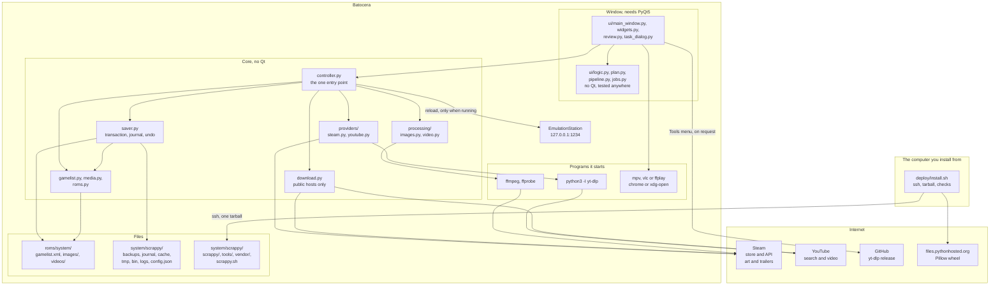
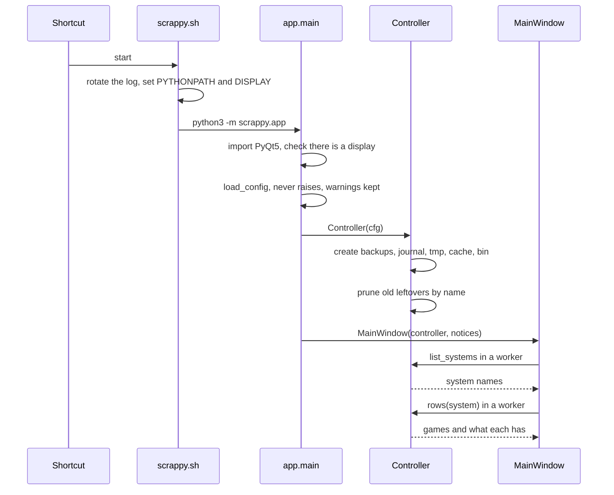
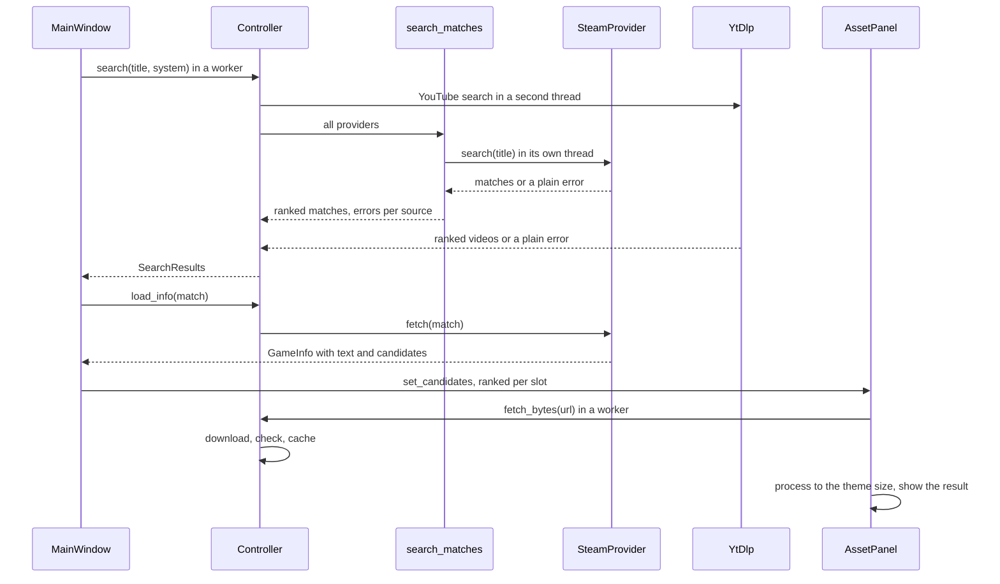
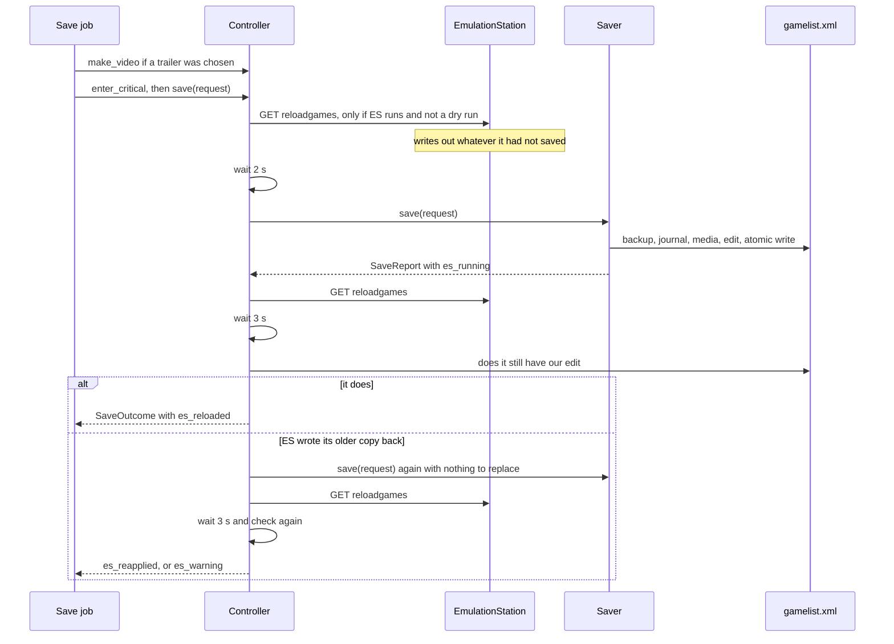
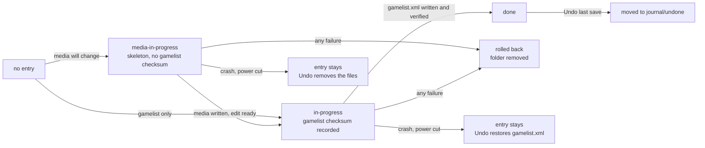
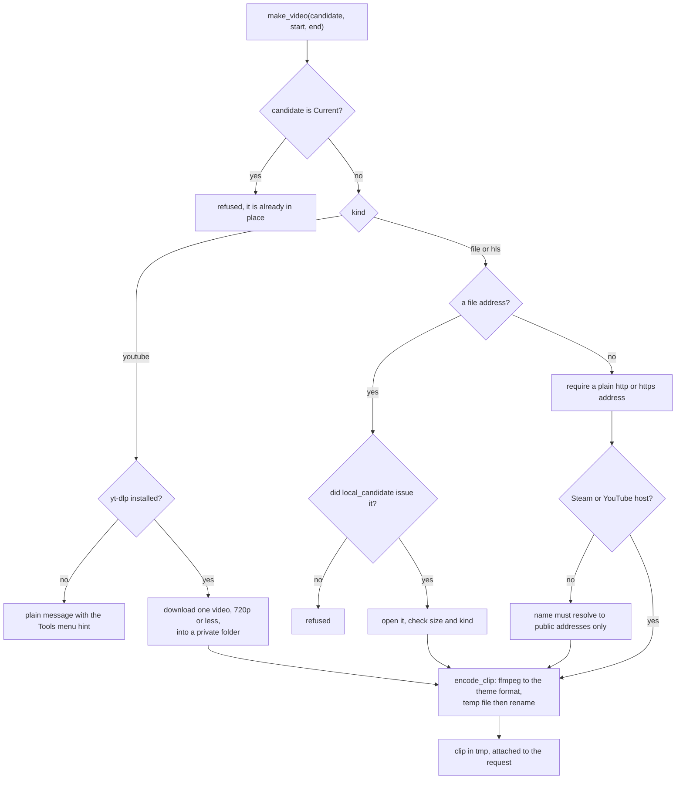
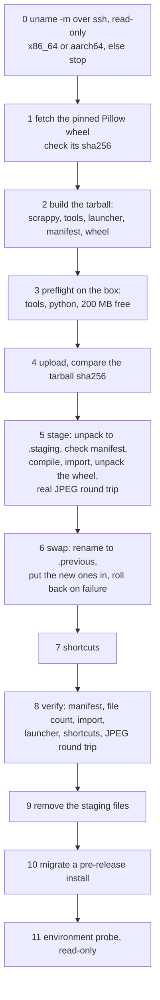

# Architecture

How Scrappy is put together, why the boundaries sit where they do, and what you need to know to change it.

**Audience.** Anyone working on the code, reviewing a change, adapting it to another system, or deciding whether to trust it with
their game library. It assumes you can read Python and a shell script. It does not assume you know how EmulationStation keeps its
game lists, what a `gamelist.xml` looks like, or how Batocera is laid out; §2 covers the vocabulary. How to *use* the program is in
[USAGE.md](USAGE.md); what it cannot do is in [KNOWN-LIMITATIONS.md](KNOWN-LIMITATIONS.md); what it talks to and writes is in
[../SECURITY.md](../SECURITY.md). Everything below was checked against the code; where an intention and the code differ, the text
says what the code does.

**Contents**

1. [Scope](#1-scope)
2. [Terminology](#2-terminology)
3. [System overview](#3-system-overview)
4. [Repository layout](#4-repository-layout)
5. [The contract with Batocera](#5-the-contract-with-batocera)
6. [Components](#6-components)
7. [Control flow](#7-control-flow)
8. [Invariants, and where they are enforced](#8-invariants-and-where-they-are-enforced)
9. [Lifecycle and teardown](#9-lifecycle-and-teardown)
10. [Limits and budgets](#10-limits-and-budgets)
11. [How to change it](#11-how-to-change-it)
12. [Packaging, deployment and CI](#12-packaging-deployment-and-ci)
13. [Testing strategy](#13-testing-strategy)
14. [Defect register](#14-defect-register)
15. [Limitations and non-goals](#15-limitations-and-non-goals)
16. [Contributing](#16-contributing)
17. [Appendix](#17-appendix)

---

## 1. Scope

Scrappy does four things:

1. **Shows what a game has and what it lacks.** For a system folder under the ROM root it lists the games (the ROM files
   EmulationStation would accept, with what the system's `gamelist.xml` says about each), marks each complete or missing something,
   and for the game you pick reads what it has now ("Current": the four media files and the seven text fields).
2. **Finds candidates.** It asks Steam and YouTube at the same time for the game's title, description, release date, developer,
   publisher, genre, pictures and trailers, and also takes pictures and a trailer file you give it.
3. **Converts what you choose to the formats the theme plays**, and shows exactly what a save would do before it does it: a
   review window with every new picture next to the current one, every changed detail old and new, and the files that would be
   replaced, linked or left alone.
4. **Saves as one transaction that can be undone.** Media are written atomically into the system's `images/` and `videos/` folders,
   only the tags it was asked for are changed in `gamelist.xml`, the previous `gamelist.xml` is backed up and an exact "before" copy
   is journaled, a failure rolls everything back, and EmulationStation, which keeps its own copy of the game lists and writes it
   back later, is asked to flush before and reload after, and the result is checked.

Out of scope on purpose, and why:

| Not done | Why |
|---|---|
| Reading ROM contents | Only file names and modification times are used. Nothing in the library is executed or opened for reading except `gamelist.xml` and media |
| Scraping a whole library | Batocera's own scraper does that. Scrappy fills the gaps it leaves, one game at a time, with a person checking each |
| ScreenScraper credentials and settings | Never read (`es_settings.cfg` is not opened) |
| Editing other tags | Only the seven text tags in `TEXT_FIELDS` and the four media tags in `MEDIA_TAGS` are ever written. Play count, favourites, ratings, hashes and unknown tags are left alone |
| Deleting a user's files | A replaced file is copied to the journal first and never deleted; Undo puts it back. The program deletes only files it made itself |
| Other EmulationStation frontends | Folder names, media names, sizes, the reload address and the install folder are Batocera's. A "frontend profile" is sketched in §11.5, not implemented |
| Updating itself | The only program it ever downloads is yt-dlp, and only when you choose the Tools menu entry |
| Secrets and API keys | No source needs one today. `scrappy/config.py` records where a key would go if one did (a separate file, mode 0600) and refuses to load or save a key-looking name in `config.json` |

## 2. Terminology

Skip this if the words are familiar.

| Term | What it means here |
|---|---|
| **Batocera** | A Linux distribution for retro gaming machines. Everything runs as root, `/userdata` survives updates, and it ships Python 3.11, PyQt5 and ffmpeg. The verified target |
| **EmulationStation (ES)** | Batocera's front end. It shows the games, and reads each system's `gamelist.xml` into memory |
| **System** | A folder under the ROM root (`/userdata/roms/<system>`) holding one platform's games, its `gamelist.xml`, and its `images/` and `videos/` folders. `switch`, `windows`, `nes`... |
| **ROM** | A game file in a system folder. Scrappy only reads its name |
| **`gamelist.xml`** | The XML file in a system folder with one `<game>` per game: `<path>`, `<name>`, `<desc>`, `<image>`, `<thumbnail>`, `<marquee>`, `<video>`, play data and more |
| **Scraper** | A program that fills a `gamelist.xml` and the media folders from an online database. Batocera has one built in (ScreenScraper). Scrappy exists for the games it finds nothing for |
| **Theme** | What ES draws. It decides which media it shows and at what size. Scrappy writes fixed sizes and does not read it |
| **Slot** | One of the four things Scrappy fills: `logo`, `boxart`, `image`, `video` (`models.SLOTS`). Each maps to a gamelist tag: `marquee`, `thumbnail`, `image`, `video` |
| **Candidate** | One possible picture or video for a slot (`models.AssetCandidate`): an address, a label, a source, sizes |
| **Current** | What a game has now, read from disk. It appears in each panel as a candidate marked `current=True` that can never be fetched, processed or written |
| **Provider, match** | A source of game information (`Provider`: `search(title)` and `fetch(match)`), and one hit it returned (`Match`) |
| **Plan** | What a Save would do, worked out from the screen before anything is written (`ui/plan.py`, `SavePlan`) |
| **Saver, transaction** | `saver.Saver`: validates, backs up, writes media, edits `gamelist.xml`, journals, and rolls back on any failure |
| **Journal** | `<data_dir>/journal/<n>/`: for each save, `journal.json`, the exact "before" copy of `gamelist.xml`, and copies of files the save replaced. What Undo reads |
| **Stale-tree guard** | Before replacing `gamelist.xml` the saver compares its modification time and size with what it read; if something else changed it, the file is read again and the edit re-applied |
| **Dry run** | `dry_run_dir` in `config.json`: the whole pipeline runs against a sandbox copy and leaves the real folders alone. Not the installer's `--dry-run` |
| **HLS** | A video delivered as a playlist (`.m3u8`) of segments. Steam trailers are HLS streams ffmpeg reads |
| **yt-dlp** | A YouTube downloader distributed as a single Python zip application. Scrappy installs it into `<data_dir>/bin` when asked |
| **Vendored Pillow** | A pinned Pillow wheel unpacked into `<install>/vendor` and put first on `PYTHONPATH`, because Batocera's own cannot do JPEG (§14). A wheel is a Python package file; a pin is the line in `deploy/vendor.txt` that fixes its name, URL and sha256 |
| **Staging, manifest** | The installer unpacks into `.staging-<time>` and checks `MANIFEST.sha256` (hash of every shipped file) before touching the installed version |
| **Demo library** | `scrappy.ui.demo`: 15 invented games on five systems, with invented sources, made in a temporary folder. `--demo` and the screenshot tool use it |
| **Seam** | A parameter or field through which a module receives its I/O (a fetch function, a clock, a runner), so a test can pass a fake. §13 |
| **Worker, job** | A background thread running one slow task for the window (`ui/jobs.py`). Nothing slow runs on the GUI thread |

## 3. System overview

Three worlds, and the thing to hold onto is that Scrappy lives in the middle: **it reads and writes one game's files in a system
folder, it reads untrusted text and pictures from the internet, and it hands some of that to ffmpeg, yt-dlp and a media player.**
The code is split so that everything that touches your files is plain Python tested without a screen, and the window is a thin layer.



Reading the diagram: every write into `LIB` goes through `saver.py` (with the one exception named in §8; the controller reaches `gamelist.py` and
`roms.py` only to read), every arrow to the internet from the core goes through `download.py` or the two providers, and `ffmpeg` is started with an argument list that `processing/video.py` builds. The Qt-free modules of the window (`ui/logic.py`,
`plan.py`, `pipeline.py`, `jobs.py`, `launch.py`) hold its decisions, which is why they can be reviewed and tested without Qt.

### 3.1 Who runs as what, and what is written where

| What | Runs as | Writes |
|---|---|---|
| `deploy/install.sh` | you, on the computer you install from; its remote steps run as the user you name on the Batocera (`root`) | on the computer: `~/.cache/scrappy/wheels`, a temporary folder. On the Batocera: only under `/userdata/system` and `/usr/share/applications` (§6.12) |
| `scrappy.sh` (launcher) | the desktop user, which is `root` on Batocera | `/userdata/system/logs/scrappy.log` (rotated at about 1 MB, three old copies) |
| `python3 -m scrappy.app` | same | the media and `gamelist.xml` of the game being saved; `<data_dir>` (`backups`, `journal`, `cache`, `tmp`, `bin`, `logs`) |
| `ffmpeg`, `ffprobe`, `yt-dlp`, players | same, started by the program | the clip, in `<data_dir>/tmp`; yt-dlp works in a private sub-folder of `tmp` that is always removed |

Batocera runs everything as root, so Scrappy does too; it does not need more than that and does not ask for more.
[../SECURITY.md](../SECURITY.md) has the threat model.

## 4. Repository layout

```text
scrappy/                    the program (Python package)
  app.py                    entry point: python -m scrappy.app [--demo]; logging, error hooks, start-up messages
  controller.py             THE entry point for the window: library, search, files, video, save, undo, EmulationStation
  saver.py                  the save transaction: media, gamelist.xml, backup, journal, rollback, undo, dry run
  gamelist.py               read and edit gamelist.xml touching only the tags asked for; backups
  roms.py                   find ROMs for a system and say which assets they lack
  media.py                  where Batocera expects a game's media files (names, folders, tags)
  models.py                 plain data classes: Match, AssetCandidate, CurrentAsset, GameInfo; SLOTS
  config.py                 settings with defaults and validation; config.json; the data folders
  atomic.py                 crash-safe file replacement with temp files that cannot be hijacked
  download.py               the safe downloader: public hosts only, size and time limits
  search.py                 ask all sources at once, merge and rank
  titles.py, titlematch.py  file name to clean title; title scoring
  dates.py                  'YYYY-MM-DD' (what you edit) to 'YYYYMMDDT000000' (what gamelist.xml holds)
  providers/                base.py (interface), steam.py, youtube.py (the yt-dlp wrapper)
  processing/               images.py (theme sizes, background removal, text logo), video.py (the ffmpeg clip)
  ui/                       main_window.py, widgets.py, review.py, task_dialog.py (need PyQt5);
                            logic.py, plan.py, pipeline.py, jobs.py, launch.py (no Qt);
                            workers.py (the Qt side of jobs);
                            demo.py, demo_data.py, demo_art.py, demo_video.py (the invented library for --demo)
tools/                      scripts that run on the box (probe_environment, box_selftest, ui_smoke, verify_media_naming)
                            and developer tools (make_screenshots, make_annotated_screenshots, fetch_demo_art, real_showcase, capture_fixtures)
deploy/                     install.sh, scrappy.sh (launcher), scrappy.desktop, icon.png, vendor.txt, extract_wheel.py
tests/                      the test suite and tests/fixtures (captured Steam and YouTube answers)
docs/                       USAGE.md, ARCHITECTURE.md (this file), KNOWN-LIMITATIONS.md, screenshots/
assets/                     logo and diagram SVGs, the social preview card
.github/                    workflows (tests.yml, build.yml), dependabot.yml, issue and pull request templates
```

There is no `pyproject.toml`: the program is not installed with pip. `deploy/install.sh` ships the `scrappy/` and `tools/` folders
as they are, and development runs from a checkout with `pytest.ini` setting `pythonpath = .`.

## 5. The contract with Batocera

Everything Scrappy writes follows what Batocera's own scraper produces, so a game saved by Scrappy looks to ES like a game the scraper
found.

| Slot | Tag in `gamelist.xml` | File, for ROM `<stem>` in `<system>` | Format | Made by |
|---|---|---|---|---|
| `image` | `<image>` | `<system>/images/<stem>-image.jpg` | JPEG 640x360, quality 88 | `images.make_image_jpg` |
| `boxart` | `<thumbnail>` | `<system>/images/<stem>-thumb.png` | PNG RGBA 396x640 | `images.make_boxart_png` |
| `logo` | `<marquee>` | `<system>/images/<stem>-marquee.png` | PNG RGBA 600x300, transparent | `images.make_logo_png`, `make_text_logo` |
| `video` | `<video>` | `<system>/videos/<stem>-video.mp4` | MP4 H.264 high, 1280x720, 30 fps, about 1.5 Mbps (cap 2.2 Mbps), AAC 128k stereo, faststart | `video.encode_clip` |

* **`<stem>`** is the ROM's file name without its extension (`media.rom_stem`; an "extension" is a dot followed by up to six
  letters or digits). A ROM in a sub-folder keeps the same stem and the media still go to the system's own `images/` and `videos/`.
  Two ROMs with the same name in different sub-folders therefore share their media.
* The tag values are relative paths with a leading `./`, for example `./images/<stem>-image.jpg` (`media.media_rel_paths`).
* **Text tags** written when they changed: `name`, `desc`, `releasedate` (as `YYYYMMDDT000000`), `developer`, `publisher`, `genre`,
  `players`. A blank value never clears a tag (`Gamelist.upsert` skips empty and whitespace-only values), so nothing in the program
  can empty a field.
* **A `<scrap>` marker** with `name` and `date` is set on every game the program changes, so you can see what it touched. Its
  `name` is `Scrappy` (`gamelist.SCRAPER_NAME`); games saved by pre-release versions carry another name. Nothing reads the marker.
* **The picture and video sizes are constants** (`IMAGE_SIZE`, `BOX_SIZE`, `LOGO_SIZE`, `VIDEO_FILTER`). They are fixed values;
  the program does not read the theme (§15).
* **Dates:** you edit `2026-02-18`, `Feb 18, 2026` or `2026`; `dates.to_gamelist` turns it into `20260218T000000` and refuses anything
  it would have to guess (day-first dates, `Coming soon`, impossible days, years outside 1970 to 2100).
* **Which art counts as "existing".** The file the game's tag points to if it is a real, non-empty file *inside* the system folder;
  otherwise the standard file above. A zero-byte file counts as missing (a failed earlier write). Art the user already has under another
  name is kept unless the user chooses to replace it (§6.9).
* **EmulationStation's reload address** is `http://127.0.0.1:1234/reloadgames` (`controller.ES_RELOAD_URL`).

## 6. Components

Each entry says what the module is for, the seam through which a test replaces its I/O, and where it is tested. The core
(`scrappy/*.py`, `providers/`, `processing/`) imports no Qt; `tests/test_controller.py::test_controller_has_no_gui_imports`
imports the controller in a fresh interpreter and fails if any `PyQt` or `PySide` module appears.

### 6.1 Small modules the rest stands on

| Module | Job | Seam and tests |
|---|---|---|
| `models.py` | `SLOTS`, `SLOT_TAGS`, and the plain data classes `Match`, `AssetCandidate`, `CurrentAsset`, `GameInfo`. No behaviour | `test_models.py` |
| `media.py` | `rom_stem`, `media_rel_paths`, `media_abs_paths`: the file naming of §5 in one place, shared by the saver, the controller and `tools/verify_media_naming.py` | pure; `test_media.py::test_rel_paths_match_batocera_scraper` |
| `titles.py` | `clean_title(file name)`: strips a known ROM extension, bracketed and parenthesised tags, `vN` version tags, trailing words such as `update` or `dlc`; falls back to the stem for tag-only names. `title_id` finds a Switch title id | pure; `test_titles.py` |
| `titlematch.py` | `normalize` (accents folded, `&` to `and`, apostrophes dropped) and `title_score(query, candidate)`, 0 to 1; penalises soundtrack, demo, DLC the user did not ask for, and a different number (`Chapter 4` is not `Chapter 5`). Used by both providers and by `search.py` | pure; `test_titlematch.py` |
| `dates.py` | `to_gamelist` and `from_gamelist` (§5). Anything not a real date between 1970 and 2100 becomes `''`, which the saver skips | pure; `test_dates.py` |
| `atomic.py` | `atomic_replace(target, fill)`: a random fixed-length temp name (`.scrappy-<16 hex>.tmp`) created with `O_EXCL \| O_NOFOLLOW`, fsync, `os.replace`; the mode of the replaced file is kept. `chmod` and `fsync` failures with `EPERM`, `EINVAL`, `ENOTSUP`, `ENOSYS` are ignored, because NTFS and FUSE drives (`/media/Windows`) refuse them; real I/O errors still propagate | `fill` callable; `test_atomic.py` |
| `config.py` | `DEFAULTS`, `VALIDATORS`, `load_config`, `save_settings`, `data_dir`. Loading never raises and never writes (the one setting the program stores itself is `intro_seen`): a missing, oversized, corrupt or non-object file gives the defaults, one bad value falls back to that key's default, and every reason goes into `Config.warnings` for the window to show. Names that look like secrets are not loaded and `save_settings` refuses them. Keys it does not know are kept untouched | `load_config(path, overrides)`; `test_config.py` |

### 6.2 `roms.py`

`rom_extensions(system, cfg_paths)` reads the extensions EmulationStation accepts for a system from `es_systems.cfg` (the shipped
one and any under `/userdata/system/configs/emulationstation`), merged. `scan_roms(system_dir, exts, max_depth=3)` returns
relative paths such as `./Sub/B.nsp`: case-insensitive, depth first, hidden entries and media folders skipped, symlinked folders
followed but never into a cycle, broken links dropped, unreadable folders ignored. A folder named like a ROM (`Game.wine`) is one ROM.
`asset_status(system_dir, gamelist, rom)` says per field (`desc`, `image`, `thumbnail`, `marquee`, `video`) whether the tag has
content **and**, for media, the file exists and is not empty; `complete` is all five. It takes anything with a `get(rom_path)`, which
is how the controller passes its pre-built index instead of scanning the XML once per ROM. Tests: `test_roms.py`.

### 6.3 `gamelist.py`

`Gamelist(path)` parses with ElementTree (a missing or empty file starts a fresh `<gameList>`). `get(rom)` returns a game's tags except
`<scrap>`. `upsert(rom, fields)` sets only the given tags, skips blank values, creates the `<game>` with its `<path>` if needed, sets
the `<scrap>` marker and re-indents *only that game* with tabs the way ES writes it, so the rest of the file's bytes are unchanged.
`to_bytes()` is exactly what `save()` writes (`<?xml version="1.0"?>` header, tabs); `save()` resolves symlinks first so a symlinked
`gamelist.xml` stays one, and goes through `atomic_replace`. `backup_file(path, backup_dir, keep=30)` copies into
`<data_dir>/backups` as `<system>-gamelist-original.xml` the first time ever (never pruned) and
`<system>-gamelist-<UTC stamp>.xml` afterwards (newest 30 kept); the names are matched exactly so another system's files or a stray
file in the folder are never adopted or pruned. Two things it cannot do: ElementTree drops XML comments, and an empty `<tag/>` may be
re-serialised differently in games that were not touched (`KNOWN-LIMITATIONS.md`). Tests: `test_gamelist.py`, including byte-for-byte
tests (`test_round_trip_is_byte_identical`, `test_new_game_bytes_match_emulationstation_layout`).

### 6.4 `processing/images.py`

All pictures are decoded and made here, with Pillow and numpy, from bytes.

- `open_image(data)` decodes only `ALLOWED_FORMATS` (JPEG, PNG, WebP, GIF, BMP, TIFF; EPS can start Ghostscript, PSD and others are
  refused), applies EXIF orientation, takes the first frame of an animation, converts palette, CMYK, 16-bit and greyscale inputs, and
  refuses a picture of more pixels than `Image.MAX_IMAGE_PIXELS` *before* decoding it (done here rather than by turning Pillow's warning
  into an error, because warning filters are process-global and this runs on worker threads).
- `cover(im, size)` scales to fill and crops the centre in one resampling step; `cover_box` computes whole-pixel boxes that are always
  inside the picture (floating-point results such as `-2e-13` used to reach Pillow, §14).
- `make_image_jpg` flattens transparency on dark grey and covers 640x360; `make_boxart_png` covers 396x640 and reports whether the source
  was so far from portrait that it was cropped; `make_logo_png` trims transparent borders and fits the result into 600x300 on a
  transparent canvas.
- `has_real_transparency` and `remove_background` (flood fill inwards from the corners that agree on a colour, tolerance 32; only the
  background connected to the border goes, so the hole of an "O" stays; it gives the picture back unchanged when fewer than two corners
  agree or the fill does not converge within a pass budget). `make_text_logo(title)` draws the title wrapped and centred when no
  logo can be found, with the first font of `FONT_CANDIDATES` that exists and Pillow's bitmap font as the last resort.
- `write_atomic(path, data)` is `atomic_replace` through a resolved path. The saver uses it for every picture and for restoring
  `gamelist.xml`.

Seam: bytes in, bytes out. Tests: `test_images.py`, `test_images_cover.py`.

### 6.5 `processing/video.py`

`build_encode_cmd(src, dst, start, end, max_seconds, bitrate, ffmpeg, duration)` is pure and returns an argument list. The window is
`_window(...)`: a start at or after the end of the source is pulled back, the length is at least one second and at most
`max_seconds`, and both are clamped to the probed duration. The picture goes through `VIDEO_FILTER`: square the pixels, fit inside
1280x720 without stretching, pad with black, 30 fps, `yuv420p`. Chapters, subtitles, data streams and metadata are dropped.

The protocol rule is the important one: for a **URL** source ffmpeg gets `-protocol_whitelist http,https,tcp,tls,crypto,httpproxy,data`
(and `-rw_timeout` of 30 s); for a **local file** it gets `file` only. A hostile playlist therefore cannot name `file://` or `concat:`.
`httpproxy` is in the list because ffmpeg opens it internally when `http_proxy` is set (§14). `_classify` rejects anything that is not an
`http(s)` URL or a plain path, and a path starting with `-` becomes `./-name`.

`encode_clip` probes the duration (`probe_duration`, 0.0 when unknown), writes to `<dst>.<8 hex>.tmp` beside the destination, polls
`cancelled` ten times a second, kills and reaps ffmpeg on timeout (30 minutes), cancellation or any exception, requires a non-empty
output, fsyncs, and `os.replace`s it into place, so a failure leaves any existing `dst` untouched. It refuses to overwrite its own
source and writes through a symlinked destination. Seams: `popen`, `probe`, `ffmpeg`, `ffprobe`. Tests: `test_video.py` (the end-to-end
ones run a real ffmpeg with libx264 and are skipped without it).

### 6.6 `download.py`: the safe downloader

The only way the core fetches a picture from an address that came from the web or from the user. `download`, `download_bytes`,
`download_to_file` and `fetch_cached` share one engine, `_run`. The rules, all enforced in this file:

| Rule | How |
|---|---|
| `http` and `https` only, also after each redirect; no credentials in the address | `_check_url`, run again on every `Location` |
| An `https` page may not redirect to `http` | `check_redirect` |
| At most 5 redirects, followed by hand so that each target is checked | `_run` loop with `allow_redirects=False` |
| Public addresses only, and the connection goes to the address that was checked | `check_destination` resolves once; `_GuardedConnection._new_conn` connects to those addresses and nothing else, so no second lookup can answer differently |
| The rule for "public" is the project's own list | `is_public_address`: `_DENIED_V4` and `_DENIED_V6` plus `_special`; IPv6 forms that carry an IPv4 address are judged by it |
| At most 25 MB while streaming (`Content-Length` only refuses early) | `_read_body` |
| Compressed answers refused (`Accept-Encoding: identity`) | `_run` |
| Connect timeout 10 s, read timeout 10 s, **one total deadline of 60 s** | a watchdog `threading.Timer` shuts the sockets down when the deadline passes, so a server that stays silent or drips bytes cannot keep a read blocked past it |
| Headers limited to 64 KB in total | `_LimitedResponse`, `_BudgetedReader` (http.client alone allows about 6 MB) |
| No cookies, no proxy variables, no `.netrc` | `_session`: `trust_env = False`, a cookie policy that allows no domain |
| Cancellation | `cancelled()` is polled between reads |
| Nothing left behind | `download_to_file` writes `<name>.<random>.part` beside the target, fsyncs, renames; any failure removes it |

`Content-Type` is reported and never trusted. The real validation is `images.open_image`, and the controller additionally refuses to cache
bytes that do not start like a picture (`looks_like_picture`). The module relies on two private urllib3 attributes
(`HTTPConnection._dns_host`, `HTTPResponse._fp`), and `test_urllib3_internals_we_rely_on_are_still_there` fails loudly if an upgrade
removes either. Looking up a name (`getaddrinfo`) cannot be bounded from Python; the deadline is checked before and after it.
Seams: `resolver`, `address_policy`, `allow_private` (the explicit opt-in used by tests and nothing else), `cancelled`, all the limits as
keyword arguments. Tests: `test_download.py`, which runs real local servers.

### 6.7 `providers/`

`base.py`: `Provider` (`name`, `search(title) -> [Match]`, `fetch(match) -> GameInfo`), `ProviderError` (a failure the user can be told
about in plain words) and `describe_error` (the same plain text for every source). A provider never leaks a raw network or parsing
exception.

**`steam.py`** uses Steam's keyless store endpoints with a plain `requests.Session` (so the system's proxy variables apply here, unlike
in `download.py`): store search, `appdetails`, and `IStoreBrowseService/GetItems` for the hashed library art. Everything that comes
back is untrusted: `_text` strips control characters and bidi marks, `_asset_url` keeps only `https` addresses on `*.steamstatic.com` or
`*.akamaihd.net` with no credentials and no odd port, lists are capped (8 matches, 20 screenshots, 8 trailers, 3 names), the description
is HTML turned into plain text and shortened to 900 characters at a word, and a malformed answer yields partial results. Trailers prefer
HLS, then DASH, then mp4. The library box art is the `_2x` capsule (600x900), declared at its true size. The transparent logo is
`.../steam/apps/<id>/logo.png`, offered only if a `HEAD` request shows a `200` `image/png`. **A DLC has no art of its own:** for an app of
type `dlc` the provider borrows box art and logo (only those) from its base game and labels them `(base game: ...)`. Seam:
`SteamProvider(session=...)`, with canned answers in `tests/fixtures/` (captured by `tools/capture_fixtures.py`, or anonymised: see `tests/fixtures/README.md`). Tests: `test_steam.py`. The provider contract, and the plan for more sources, are in [PROVIDERS.md](PROVIDERS.md).

**`youtube.py`** runs yt-dlp, a Python zip application, with the system Python in isolated mode (`python3 -I <data_dir>/bin/yt-dlp`).
- Search: `ytsearchN:<title> <platform hint> official trailer`, `--flat-playlist --dump-json`, up to 20 results; `parse_search_output` keeps
  only entries with a valid 11-character id (the id is the only thing kept of the address; every address is rebuilt from it),
  `https` thumbnails on `*.ytimg.com`, no live streams and no members-only videos, cleaned text; `rank_candidates` drops videos under 10 seconds
  or over 20 minutes and prefers official trailers over reactions and reviews, verified channels, and titles that contain the game's words.
- Download: one video of at most 720p and 300 MB into a private sub-folder `.yt-*` that is always removed; mp4 first, then webm. AV1 and VP9
  are allowed on purpose (§14); the encoder re-encodes everything to H.264.
- Every call passes `--ignore-config --no-plugin-dirs --no-cache-dir`, the user's text comes after `--`, `run_process` kills the process
  group on timeout (search 90 s, download 20 minutes), cancellation or more than 2 MB of output, and keeps only the tail of stderr.
- `YtDlp.update()` is the one place the program downloads code: from `github.com/yt-dlp/yt-dlp/releases/latest/download/yt-dlp`, at most 25 MB,
  the final address must be GitHub over `https`, the file must start with `#!` and be a zip with a `__main__.py`, and `python -I <file> --version`
  must succeed before it replaces the installed copy. It is not checked against a published hash. It only happens when the user chooses
  Tools > Install / update YouTube downloader (or the Install button in the Trailer panel).
- `YtDlp.install(opener, progress, cancelled, stage)` does that work and returns an `InstallResult` (path, the version the new copy printed,
  the version it replaced, whether a copy was there before); `update()` and `ensure()` return only the path. While the file downloads it calls
  `progress(done, total)`, where `total` is the size GitHub announced (`Content-Length`) or `None`; an announced size over the cap is refused
  before the first byte is read, and a download that ends short of the announced size is an error. `cancelled()` is polled between reads and
  before each quiet step (check, smoke run, version of the old copy, replace); a cancel raises `YouTubeCancelled`, removes the temporary file
  and leaves the installed copy as it was. `stage(text)` announces each quiet step.

Seams: `YtDlp(bin_dir, python, runner)`, `ensure(opener)`, `update(opener)`, `install(opener, progress, cancelled, stage)`. Tests: `test_youtube.py`, with captured output in
`tests/fixtures/youtube_search_supertuxkart.jsonl` and a few tests that run a real child process.

### 6.8 `search.py`

`search_matches(providers, title, timeout, cancelled)` starts one daemon thread per provider, each writing into its own `Future`, so
nothing is shared and a slow or broken source costs only its own answer. The timeout is **one deadline for the whole search**, not per
source; `cancelled` is polled every 50 ms. The result (`SearchOutcome`) has the matches best first (a provider's score is used only if
it is a finite number in (0, 1], otherwise `title_score` is computed; duplicates by `(source, id)` keep the best), a plain message per
failed source, and a status per source. `rank_assets` (best candidates first for each slot: 16:9 for `image`, portrait for `boxart`, transparent for `logo`, then
area) is a pure helper the window uses. `merge_infos` (the first non-empty value of each field wins, all pictures and videos kept) is tested but
not called by the window, which loads the details of the one match the person picked. Tests: `test_search.py`.

### 6.9 `saver.py`: the transaction

The most important file for anybody's library. Everything that changes `gamelist.xml` or a media file goes through `Saver.save`, one at a
time (a lock; the window calls it from a worker), and everything it does can be undone by `Saver.undo_last`.

**`SaveRequest`** names the system folder, the ROM path, the text `fields`, up to three picture payloads (`bytes`), an already-encoded video
(`Path`; copied, not moved) and `replace`, the set of media tags allowed to overwrite an existing file.

**The steps of `save`:**

1. **Validate before touching the disk.** The ROM path must be relative and plain (no `..`, no drive letter, no NUL). Field names must be in
   `TEXT_FIELDS`; characters XML 1.0 cannot hold are removed. Each payload must be non-empty (a video must be a regular, non-empty file).
   Every media path is resolved and must lie **inside the system folder**: `..`, absolute paths, a symlinked `images` or `videos` folder,
   or a symlinked file that leads elsewhere are refused (`_resolve_targets`).
2. **Plan each media item** (`_plan`): `create` (nothing there), `replace` (it exists and its tag is in `replace`, or it is zero bytes), or
   `keep` (it exists, not in `replace`).
3. **Load `gamelist.xml`** (`_load_gamelist`): read twice around the parse to be sure it did not change meanwhile; a missing or empty file
   starts fresh; a **damaged one is never overwritten** (`SaveError`). Take a backup if this is the first save of the session for that file
   or it changed behind our back (`_known` holds the stamp last seen), and copy the exact bytes to `<journal>/<n>/gamelist.before.xml`.
4. **Decide, then edit in memory** (`_decide`, `_prepare_gamelist`). The slot rule: art the user already has is theirs. If the game's tag
   points to a non-empty file with a name other than ours, that slot is kept as it is (nothing written, tag unchanged) unless its tag is in
   `replace`. A kept standard file is *linked* (the tag is set) only if the tag is empty or leads to a missing or empty file.
5. **Stage the media** (`_stage_media`): create missing folders (remembered, so rollback can remove them), compute each payload's sha256, and
   copy every file that will be replaced into `<journal>/<n>/replaced/`. Nothing in the real media changes yet. Then write a **skeleton
   `journal.json`** (state `media-in-progress`, no `gamelist` checksum), so that a crash during a long video copy still leaves a usable Undo.
6. **Write the media** (`_write_media`): atomically, and re-checking before each write that the target is still inside the system folder
   (a folder could have been swapped for a link since step 1).
7. **Stale-tree guard.** Compare `gamelist.xml`'s `(mtime_ns, size)` with the stamp seen at load. If it changed (usually ES), reload it and
   apply the edit again; the edit only sets the tags it was asked to set, so applying it twice is harmless. After 3 attempts raise
   `StaleGamelist`, and everything done so far is rolled back.
8. **Write `journal.json`** (state `in-progress`, with the checksum of the new bytes), then `gl.save()`, read the result back, verify it is
   well-formed XML that contains the game (`_verify`), remember its stamp, and set the state to `done`.
9. **Prune** the journal (§9) and report: `SaveReport` has `written`, `kept`, `replaced`, `backup`, `journal`, `linked`, `es_running`,
   `dry_run`.

**Rollback.** Any exception after the first write calls `_rollback`: restore `gamelist.xml` from the "before" bytes (or delete it if there was
none), delete the files this save created, copy replaced files back with their old mode, remove folders it created, and delete the journal
folder. What cannot be undone is listed in the error ("the saved copies are in ..."), and the journal folder is kept in that case. An
`OSError` becomes a `SaveError` in plain words (`_explain`: disk full, no permission, read-only drive, name too long).

**Undo** (`undo_last(force=False)`) takes the newest folder that has a `journal.json`. It refuses (`UndoRefused`) if `gamelist.xml` is no longer
the file the save wrote, unless `force`, in which case the file being discarded is kept as `gamelist.discarded-by-undo.xml` in that save's
folder. If it already equals the "before" copy (an earlier undo was interrupted) that step is skipped, which makes undo safe to repeat.
Files the save created are removed only if their checksum still matches; files it replaced are restored only if the file is still the one the
save wrote (or gone); anything that changed since is left alone and listed in `left_alone`. A skeleton entry leaves `gamelist.xml` alone.
When the recorded absolute path of a saved copy is stale (the installer's migration renames the data folder), `_saved_copy` looks in
`<save folder>/replaced/` and uses the file only if its checksum is the recorded one. The finished folder moves to `journal/undone/`.

**Dry run.** With `dry_run_dir` the saver copies `gamelist.xml` and the game's existing media into `<dry_run_dir>/<system>/` on first use,
uses `<dry_run_dir>/backups` and `/journal`, and runs the identical code on the copy. The dry-run folder inside the system folder is refused.

**Concurrency and EmulationStation.** One lock serialises saves and undo within a process; there is no lock between processes (the stale-tree
guard is the defence). `emulationstation_running()` scans `/proc` for a process whose `comm` starts with `emulationstatio` or whose `argv[0]` is
`emulationstation`; the report carries it so the controller knows to reload (§7.5). Seams: `Saver(backup_dir, journal_dir, dry_run_dir=...,
journal_keep=..., es_running=...)`. Tests: `test_saver.py`; the guarantees are listed in §8.

### 6.10 `controller.py`: the one entry point

The window never touches the saver, the downloader, a provider or yt-dlp directly. `Controller(cfg, providers=None, ytdlp=None, encode=...,
fetch=None, es_configs=None, resolver=None, ..., es_running=None, es_reload=None, sleep=..., es_waits=..., probe=None)` owns them, creates the
data sub-folders (`backups`, `journal`, `tmp`, `cache`, `bin`), prunes old leftovers (§9) and exposes:

| Method | Does | Notes |
|---|---|---|
| `list_systems()`, `rows(system, only_missing)` | the system folders with games; the games with what each has, incomplete first, newest ROM first among them | read the ROM drive (NTFS or a network share can be slow): call from a worker. A damaged `gamelist.xml` still lists the games and says why in `RomRow.problem` |
| `load_current(system, rom, cancelled)` | the seven text fields and, per slot, the file the tag points to (else the standard name), with a 640 px preview and the video's length (`ffprobe`, 8 s) | never writes. Reads only inside the system folder. An unreadable picture is still "there", with `problem` set |
| `search(title, system, cancelled)` | all providers (`search_matches`) plus YouTube, concurrently, each with its own deadline (`search_timeout`, `youtube_search_timeout`) | one source failing is an entry in `errors`, never an exception |
| `load_info(match)` | `Provider.fetch` of the provider that made the match | |
| `fetch_bytes(url, local_ok, cancelled)` | the bytes of a picture | `current://` is refused; `file://` only for an address `local_candidate` issued; everything else through `download.fetch_cached`, checked with `looks_like_picture`, cached, cache trimmed to 200 MB |
| `local_candidate(slot, path)` | a candidate for a file the user chose (`source="your file"`) | the only way a local file can be read; the address is recorded, and `fetch_bytes` / `make_video` read only recorded ones |
| `make_video(candidate, start, end, cancelled)` | cuts and encodes into `<data_dir>/tmp/clip-<hash>.mp4` | YouTube: download into a private folder, then encode; a user file; or an `http(s)` address on a Steam or YouTube host or one that resolves to public addresses. Anything else, including a `file://` address nobody issued, is refused |
| `build_request(...)` | a `SaveRequest` | lets through only `TEXT_FIELDS`, only changed values (with `current=`), only real JPEG or PNG bytes, only replace tags the saver knows; `link=` re-links an existing standard file |
| `save(req)`, `undo(force)` | the transaction **plus** the EmulationStation protocol of §7.5 | return outcomes with `es_reloaded`, `es_reapplied`, `es_warning` |
| `ask_es_to_reload()` | `True` if EmulationStation answered the reload request (never raises; uses the injected `es_reload` when there is one) | the Tools action and the Reload button |
| `reload_es()` | a single `GET` to the reload address, no proxy; returns a status sentence | kept for scripts; the window uses `ask_es_to_reload()` |

Safety rules that live here and nowhere else: a local file is read only if this controller issued it; `ffmpeg` never gets a path or scheme
from web data; the cache and `tmp` are pruned by name pattern only and never through a symlink; and every error a person can fix is a
`ControllerError` (a `ProviderError` that is also a `ValueError`), so `describe_error` shows it as a plain sentence.

### 6.11 `app.py` and `ui/`

**`app.py`** imports no Qt at the top, so a missing PyQt5 or display ends in a plain message (stderr, the log, and a `zenity` or `xmessage`
dialog when one exists) instead of a traceback. It sets up logging (stderr plus a rotating `<data_dir>/logs/scrappy.log` of 500 KB and two
older copies), installs excepthooks so an exception in a slot is logged and shown in the status line instead of aborting the process (PyQt5
aborts by default), loads the config, builds the `Controller` and the window. `--demo` builds the invented library instead and touches
nothing real.

**The window** is split on one rule: *decisions are Qt-free, drawing is Qt*.

| Module | Qt | Job |
|---|---|---|
| `main_window.py` | yes | builds the screen, starts jobs, shows results. Every slot is wrapped in `safe`; a result for a game or a match the user has already left is dropped (`_bound` and a review token). The two Tools actions go through `run_task`, which opens one `TaskDialog` at a time. Also: the Install button of the Trailer panel (shown while `ytdlp.available()` is false), the Reload button beside the status line (shown after a save that EmulationStation did not take), and the one-time tip (`intro_seen`) |
| `widgets.py` | yes | `CheckerLabel` (a checkerboard behind transparent pictures), `AssetPanel` (candidates, Current, Include, Remove background, Paste link, Choose file, drop), `VideoPanel` (start, end, Preview, and the Install YouTube downloader button beside its hint line), `FoundHint`. Web text only in plain-text labels; the GUI thread receives only small `QImage`s |
| `review.py` | yes | `ReviewDialog`, a read-only view of a `SavePlan`. Decodes nothing. Cancel is the default button when files will be replaced, and key auto-repeat is ignored for a moment after it opens |
| `task_dialog.py` | yes | `TaskDialog`: a modal window for one slow task that runs through the window's `JobGroup`. States (the round mark is painted, not a font glyph): running (message, busy or percentage bar with "x of y MB", Cancel when the task is cancellable), success (green check mark, the task's own lines), failed (red cross, the reason from `describe_error`, a hint, a collapsible technical `Details` box), cancelled. The final state stays until OK. The task gets a `TaskContext` (`cancelled()`, `progress(done, total)`, `message(text)`); whatever it does, even `SystemExit`, ends in a final state; a result that arrives after the dialog was closed or deleted is dropped; Esc or the close button while running means Cancel; real clicks and keys are ignored for 0.4 s after the result appears (the second click of a double click cannot dismiss it) |
| `workers.py` | yes | the Qt dispatcher that queues a job's result onto the GUI thread |
| `logic.py` | no | texts, sizes, clip ranges, link checks (`normalize_link`), `web_search_url`, **`preview_command`** (the argument list for mpv, vlc or ffplay), `saved_message`, `undo_message`, `date_problem` |
| `plan.py` | no | `build_plan(...)`: from the state of the panels and boxes to a `SavePlan` (written, replaced, linked, left alone, with reasons), and from it the `replace` set, the link set and the text fields of the request |
| `pipeline.py` | no | `process(slot, raw, remove_bg)` to a `Processed(data, note, warning)`, `load_candidate`, `text_logo`, previews. What the window shows is the exact bytes that get saved |
| `jobs.py` | no | `Job` (cancel flag, `enter_critical`, `notify`) and `JobGroup` (one daemon thread per job, outcome delivered through an injected `post`; a cancelled job's result is dropped). `report_exception`, `safe`, `guarded_event` |
| `launch.py` | no | `launch(argv, name)`: `Popen` detached from the keyboard, stderr logged under a name, a thread that waits for the process so none is left a zombie, the last error line kept for the status line |

`enter_critical()` is the point of no return: a save that has started writing cannot be cancelled and the window will not close under it.
The rule for Save in `plan.py` is stated in one place: a slot is written only when it is ticked, shows a new candidate (never Current) and has a
usable result; a Current file the game list does not mention is linked only if its slot is ticked; only text that differs from the current value
is written.

Tests: `test_ui_logic.py`, `test_plan.py` (no Qt); `test_ui_qt.py` (the real window, offscreen), `test_review_dialog.py`,
`test_panels_current.py`, `test_app_icon.py`, `test_task_dialog.py` (Qt).

### 6.12 Deployment pieces

**The installer, `deploy/install.sh`** runs on the computer you install from (bash 3.2 compatible, which macOS ships). Its phases are in §7.9;
the files it works with:

- `deploy/vendor.txt`: one pinned Pillow wheel per architecture (`x86_64`, `aarch64`), each `sha256  file name  https://files.pythonhosted.org/...`,
  the architecture taken from the platform tag in the file name. The installer validates every line, refuses two pins for one architecture
  or a tag that names neither, and takes the pin for the machine's `uname -m`.
- `deploy/extract_wheel.py`: runs **on the box** with only the standard library. Checks the wheel's sha256 against the pin, validates *every*
  member name (absolute paths, `..`, backslashes, drive letters, NUL, symlinks refuse the whole wheel), extracts only `PIL/`, `pillow.libs/` and the
  `pillow-*.dist-info/` folder into a fresh directory, caps member count and size, and writes a `VENDOR.sha256` manifest.
- `deploy/scrappy.sh`: the launcher the shortcuts run. `cd`s into the install folder and sets `PYTHONPATH="$APP_DIR/vendor:$APP_DIR"`, `DISPLAY=:0.0`
  if unset, `QT_QPA_PLATFORM=xcb`, rotates `/userdata/system/logs/scrappy.log` at 1 MB (three old copies) and `exec`s `python3 -m scrappy.app`.
  It deliberately does **not** use `python3 -I`: isolated mode ignores `PYTHONPATH` and the current directory, so `-m scrappy.app` would not find the
  package next to it. Overrides for tests: `SCRAPPY_HOME`, `SCRAPPY_LOG`, `SCRAPPY_PYTHON`.
- `deploy/scrappy.desktop` and `deploy/icon.png`: the shortcut and its icon (made from `assets/logo.svg`).

**On-box tools** (`tools/`, standard library only where noted):

| Tool | Does |
|---|---|
| `probe_environment.py` (stdlib only) | read-only OK / WARN / FAIL report: Python, PyQt5, Pillow (and a real JPEG round trip with the system and the vendored copy), ffmpeg, mpv, yt-dlp, free space, EmulationStation. The only network traffic is `GET /` and `GET /runningGame` on `127.0.0.1:1234`; any other path is refused. The exit code is always 0, except `--pillow-check --strict`, the gate the installer uses |
| `box_selftest.py` | end to end on the real code in a throw-away sandbox: pictures, trailer, the saver (create, keep, replace, undo, stale, refused links, damaged gamelist, dry run), the downloader against a local server, the address policy, an offscreen Qt. `--network` and `--youtube` are opt-in and need the internet. Exit 1 if a check fails |
| `ui_smoke.py` | builds the real window on the minimal demo library and checks the wiring; prints `UI SMOKE OK` |
| `verify_media_naming.py` | strictly read-only: compares the media names in a system's `gamelist.xml` with `scrappy.media` and classifies each as exact, extension, suffix, folder or other |

**Developer tools:** `make_screenshots.py` (§6.13), `make_annotated_screenshots.py` with `annotated_spec.py` (the numbered pictures of `docs/USAGE.md`, drawn from the live widget geometry on the invented library), `fetch_demo_art.py` and `real_showcase.py` (the real-title set), `capture_fixtures.py`
(records real Steam answers for the tests, one request each, a second apart).

### 6.13 The demo library and the screenshot tools

`python -m scrappy.app --demo` runs the real window on a library that exists only for the session, in a temporary folder removed on exit.
`scrappy/ui/demo_data.py` defines 15 invented games on five systems (`nes`, `snes`, `megadrive`, `gb`, `psx`), each in a state: `complete`,
`partial` (some media, some text), `rom-only` (not even in `gamelist.xml`), or `desc-only`. `demo_art.py` draws their pictures (pixel art, with
Pillow, deterministic: two builds are byte-identical), `demo_video.py` makes six-second trailers by piping frames to ffmpeg (a tiny
placeholder if ffmpeg is missing). `demo.py` assembles it (`assemble_demo`, `build_demo`) with an invented `ShowcaseProvider` that answers
for every game, an invented YouTube stand-in, a stand-in encoder and a stand-in `ffprobe`, and returns a `DemoEnv` whose `cleanup()` removes
everything. `build_minimal_demo` is the older three-game fixture that many window tests use. Nothing here reaches the network (§8). `tools/make_screenshots.py` drives the window the way the tests do and saves six PNGs (`01-library` ... `06-trailer`). By default it uses the
invented library. With `--real`, `tools/real_showcase.py` supplies 16 real, well-known games on eight systems with their real artwork, which
`tools/fetch_demo_art.py` has downloaded once into `~/.cache/scrappy-demo-art/` (or `SCRAPPY_DEMO_ART`), **outside the repository**. The fetch
tool contacts only Steam and the libretro-thumbnails repositories on GitHub, one request at a time with pauses, caches everything, never asks
twice for the same thing, stops after three errors in a row or at the first "slow down", and stops for good after 400 requests (counted across
runs in `requests.json`). No real trailer is ever downloaded: the "trailers" are slideshows ffmpeg makes from the cached stills. **The rule for third-party artwork:** none of it enters git. `tests/test_real_showcase.py` fails if a picture or video is tracked outside
`docs/screenshots/` and `assets/` (and `deploy/icon.png`), if anything but the listed screenshots and their notice is tracked in
`docs/screenshots/`, if a cache file is tracked, and if the screenshot folder's `README.md` lacks the trademark notice and the table that names the
source of each picture. Only the finished screenshots are committed; `docs/screenshots/README.md` is the notice.

## 7. Control flow

Every slow step runs in a worker (`JobGroup.start`); the diagrams show the worker's side. A result that arrives after the person has moved to
another game, system or match is dropped (`MainWindow._bound`, a review token, and a check that the match box still shows the same match).

### 7.1 Start-up



Failures end in a plain message, never a traceback: no PyQt5 or no display (`app._fail`: stderr, the log, and a `zenity` or `xmessage`
dialog when one exists), a data folder that cannot be created (a message box), a bad `config.json` (defaults and a yellow note at the top
of the window). With `--demo`, `build_demo()` replaces the config and the controller's sources, and `DemoEnv.cleanup()` runs when the window
closes.

### 7.2 Selecting a game: "Current"

`select_row` cancels the previous game's jobs, puts the cleaned title in the search box, resets every panel and starts the `current` job:
`Controller.load_current` reads `gamelist.xml` and, per slot, the file the tag points to (else the standard name), decodes pictures in the worker
into a 640 px preview and asks `ffprobe` for the video's length. Each panel then shows **Current** as its first entry (or "Current: none"), and the
seven boxes show the values in `gamelist.xml`. Nothing is written, and nothing about the game is looked up yet.

### 7.3 Searching, choosing a match, loading candidates



The search has two deadlines that do not wait for each other: `search_timeout` (20 s) for the providers and `youtube_search_timeout`
(45 s) for YouTube. A source that fails or is late becomes one line in the status ("Problems: ..."); the others still answer. A panel that has
a Current picture **stays on Current** after a search (looking never replaces anything); a panel with nothing yet shows the first new candidate.
For text, a box that already has text is never changed by a search: where the found value differs, a "found: ..." line with a **Use** button
appears; an empty box is filled, and follows the chosen match until the person types in it.

Pictures are fetched and processed *as they are shown*: `AssetPanel` starts a worker per candidate, `pipeline.load_candidate` fetches through
`Controller.fetch_bytes`, decodes with `open_image` and produces the exact bytes that would be saved (`process`), and the panel shows that
result with its note ("600x300 PNG, transparent"). Six processed results are kept per panel.

### 7.4 From Save to the review window

`MainWindow.do_save` runs on the GUI thread and reads nothing from disk. It refuses politely if Current has not loaded, pictures are still
loading, or the date box holds a date it cannot read. `make_plan()` collects each panel's state into `PicturePick`s and a `VideoPick`, and the
seven boxes into a dict; `plan.build_plan` turns them into a `SavePlan` (what to write and whether it replaces something, what to link, which
text changed with old and new, what is left alone and why). `request_for(plan)` builds the `SaveRequest` through `Controller.build_request`, which
validates it again. `review(plan)` shows the `ReviewDialog` and returns true only if the person pressed **Save** in it; an empty plan offers
only Close. Only then does the `save` job start (§7.5). Nothing before this point has written anything.

### 7.5 Save, with EmulationStation running

**Why this exists.** EmulationStation reads every `gamelist.xml` into memory at start and keeps that copy. It writes it back when it exits,
when the person chooses "update game lists", and after a game is played (the play count changes). A program that edits the file on disk
while ES is running will have its edit replaced the next time ES writes, and nothing will say so. In practice the save works, and the new
details stay only if ES is made to read the file again (§14). So the controller does not trust a
single write. It asks ES to reload *before*, so that ES writes out what it has not saved yet and the file Scrappy edits is current; it
asks ES to reload *after*, so ES's memory matches the file; it *checks* that the edit is still there; and if ES wrote its older copy
back anyway, it applies the edit **once more**. The edit is idempotent (it only sets the tags it was given) and the media files are already
in place, so the second pass is cheap and safe.



The details that matter:

- **When ES is not running** (`/proc` scan finds no process) there are no calls and no waits; the report says `es_running=False` and the
  status line is the plain "Saved ...". **In a dry run** ES is never contacted.
- **"Still has our edit"** (`Controller._list_has_edit`) is true if the file is byte-for-byte what the journal recorded, or if the game's entry
  still has every text field that was set and a tag for every picture or video that was saved. So ES rewriting the file *with* our entry in it
  is not a problem.
- **If ES cannot be reached** the save stands and the outcome has `es_reloaded=False`; the window then shows the manual hint (restart ES from its
  menu, and do it before making more edits).
- **At most one repeat.** If the second check also fails, `es_warning` tells the person to quit ES completely and press Save again. The files are
  already in place, so the second Save only has to re-apply the text.
- A save that had to be applied twice has two journal entries; `Controller._extra_entries` remembers that, and **Undo undoes both** in one step.
- The window's last word is `logic.saved_message`: how many files, whether a backup was taken, whether ES was reloaded or the edit had to be
  applied again, and the hint when it could not be reloaded.

What this does not catch: an overwrite that comes later than a few seconds after the save (ES exit, a game played). The remedy is to save the game
again; the files are kept and linked again. The program never stops or restarts ES (`KNOWN-LIMITATIONS.md`).

### 7.6 Inside the saver: states of a journal entry



A skeleton is written only when at least one media file will be created or replaced, and always *after* the old copies of replaced files were
saved and *before* the first media write. A `gamelist.xml`-only save goes straight to `in-progress`. After a crash, Undo reads whatever state it
finds: a skeleton leaves `gamelist.xml` alone (it was never touched), an `in-progress` one restores it if it is the file whose checksum was recorded.

### 7.7 Undo

`Controller.undo(force)` mirrors the save: it returns `None` if the journal is empty; with ES running it asks ES to reload first and waits;
`Saver.undo_last` does the work (§6.9); entries made by a re-apply are undone with `force=True` because our own second save changed the file;
then ES is asked to reload, and `_undo_holds` checks the restored list (same bytes as right after the undo, or the game no longer points to any
file the undone save created). If ES wrote its list back, the restored bytes are written once more with `atomic_replace`, ES reloads again, and
the check is repeated; a second failure sets `es_warning`. `UndoRefused` is not swallowed: the window turns it into the "Undo anyway?" question
and calls again with `force=True`. After an undo the window reads the game again, so its panels show what is on disk.

### 7.8 Making the trailer



The clip's name is a hash of the address, start, end, maximum length and bitrate, so two ranges of one trailer do not overwrite each other. The
private download folder is removed in a `finally`, also on failure, timeout or cancellation. Encoding a long trailer can take a minute or more on
the box; `cancelled` is polled ten times a second and ffmpeg is killed and reaped on cancel.

### 7.9 The installer



Phases 0 to 4 change nothing on the box except the staging tarball. Phase 5 runs against a *new* folder, `.staging-<time>`, and `cd`s into it
first: Python puts the current directory first on `sys.path`, and in the install folder that would be the *old* `scrappy/`, so the import test
could pass or fail for the wrong version. The check also asserts that the imported package's real path is the staged one. Phase 6 renames
`scrappy`, `tools` and `vendor` to `*.previous` and moves the new ones in; if any `mv` fails, all three are put back. User data (`bin`, `cache`,
`backups`, `journal`, `logs`, `config.json`) is never in the list of things swapped. A `--dry-run` prints all of it, including each remote
script, makes no connection to the machine, but does build the package in a temporary folder and fetch the wheel into the cache if it is not there.
`SCRAPPY_ARCH` stands in for `uname -m` in a dry run only.

**Migration of a pre-release install** (phase 10, `script_migrate`; the pre-release version was named `game-asset-fixer`) runs only after the new version is installed *and verified*, so a failed install
never costs the old one. If neither the old folder (`/userdata/system/game-asset-fixer`) nor its shortcuts exist it prints "nothing to migrate".
Otherwise: refuse if a process whose command line contains `gaf.app` is running; move `config.json`, `backups`, `journal`, `cache`, `bin` into the
new folder, each **only if the new folder does not already have it** (an empty folder the installer just made does not count); if the moved
`config.json` names the old folder, rewrite those paths and keep the original as `config.json.before-migration`; rename the whole old folder to
`game-asset-fixer.old-<time>` (never deleted); remove the old shortcuts; leave the old launcher logs where they are. Because moving the journal
makes the absolute paths in its entries stale, Undo looks next to `journal.json` for the saved copy of a replaced file (§6.9). Running it twice
changes nothing the second time.

**Uninstall** removes `scrappy`, `tools`, `vendor` and their `.previous` copies, the launcher, icon, manifests, `VERSION`, `.staging-*` and the
shortcuts, then removes the install folder only if it is empty. User data stays unless `--purge --yes`. It leaves a pre-release install and its
`.old-<time>` backups alone and says so.

### 7.10 Failure paths

| Failure | What happens | Guard |
|---|---|---|
| Steam times out or is unreachable | one line in the status ("Steam did not answer in time"); YouTube and the rest carry on | `test_search_reports_provider_errors_and_keeps_going`, `test_search_matches_times_out_slow_provider` |
| yt-dlp not installed | the YouTube source reports "not installed yet" with the Tools menu hint; nothing is contacted for it | `test_search_reports_missing_ytdlp_without_failing` |
| A picture host is on your own network | `BlockedDestination`: "... is on your own network or not a public website, so it was not contacted" | `test_private_destinations_are_blocked_by_default` |
| A picture cannot be decoded, or is not a picture | the panel says why; the slot is left out of the plan and listed under "Left as they are" | `test_a_picture_that_cannot_be_loaded_is_listed_as_left_out` |
| `gamelist.xml` is damaged | the games are still listed, with a note; nothing is saved; the file is not touched | `test_gamelist_that_cannot_be_parsed_is_never_overwritten`, `test_rows_with_a_damaged_gamelist_still_list_the_games_and_say_why` |
| Disk full, no permission, read-only drive during a save | full rollback; a plain message ending "Nothing was changed." | `test_disk_full_while_writing_media_rolls_everything_back`, `test_read_only_system_folder_gives_a_permission_message` |
| `gamelist.xml` keeps changing while saving | after 3 attempts `StaleGamelist`; nothing left behind | `test_gamelist_that_keeps_changing_raises_stale_and_leaves_nothing_behind` |
| Power cut or kill during a save | no half-written file (every write is a rename); the journal entry that exists is enough for Undo | `test_a_power_cut_leaves_a_journal_that_undo_can_use`, `test_a_crash_mid_media_leaves_a_journal_that_undoes_exactly` |
| ES cannot be reached after a save | the save stands; the window tells the person to restart ES | `test_reload_that_fails_keeps_the_manual_hint_case` |
| ES overwrites the list twice | a plain warning to quit ES and Save again | `test_clobbered_twice_gives_a_plain_warning_and_stops` |
| Undo, but the list changed since | `UndoRefused`; the window asks "Undo anyway?" | `test_undo_refused_asks_again_and_can_force` |
| The upload to the box is damaged | detected by the sha256 compare; the installed version is untouched | `test_damaged_upload_is_detected_and_old_install_survives` |
| A staged file does not compile, or Pillow cannot do JPEG | the install stops before the swap | `test_broken_python_file_is_caught_before_the_swap`, `test_a_vendored_pillow_that_cannot_do_jpeg_stops_the_install` |

## 8. Invariants, and where they are enforced

Rules the rest of the system relies on. Each is checked in one place and has a test unless the last column says otherwise. Test names are
checked by `tests/test_docs.py`, which fails if one stops existing.

| Invariant | Enforced in | Tests |
|---|---|---|
| Every write to a library goes through the saver, with one exception: the controller writes the restored `gamelist.xml` once more if ES wrote its list back after an Undo | `Saver.save`, `Saver.undo_last`; `Controller.undo` (the exception, via `atomic_replace`) | `test_controller_es.py`: `test_undo_clobbered_once_is_restored_again`. **No test asserts the closed set globally** |
| Every media path lies inside the system folder, checked at planning time and again right before each write | `Saver._resolve_targets`, `_check_inside`; `_clean_rom_path` | `test_symlinked_media_folder_pointing_elsewhere_is_refused`, `test_symlinked_media_file_pointing_elsewhere_is_refused`, `test_media_folder_swapped_for_an_outside_symlink_during_the_save_is_caught_at_write_time`, `test_unsafe_rom_paths_are_refused` |
| Only the seven text tags and four media tags are ever written | `saver.TEXT_FIELDS`, `MEDIA_TAGS`, `_clean_fields`; `Controller.build_request` | `test_only_text_fields_are_accepted`, `test_build_request_rejects_fields_the_saver_may_not_write`, `test_build_request_keeps_only_whitelisted_non_blank_text` |
| A blank never clears a field, and an unchanged field is not rewritten | `Gamelist.upsert`; `controller.changed_fields` | `test_upsert_skips_empty_values`, `test_changed_fields_keeps_only_real_changes`, `test_text_the_box_shows_differently_is_not_rewritten` |
| Art the person already has is kept unless they chose to replace it | `Saver._plan`, `_decide`; `plan.build_plan` | `test_existing_files_are_kept_unless_replace_is_requested`, `test_kept_file_does_not_overwrite_a_tag_that_points_to_a_real_file`, `test_keep_with_a_tag_pointing_to_another_existing_file_writes_nothing_for_that_slot` |
| "Current" is never written, fetched, processed or encoded | `AssetCandidate.current`; the panels' `pick()`; `pipeline.load_candidate`; `Controller.fetch_bytes`, `make_video` | `test_a_current_marked_candidate_is_never_written_whatever_the_panel_says`, `test_current_shown_writes_nothing_even_when_included`, `test_a_current_address_cannot_be_fetched`, `test_a_current_candidate_cannot_be_encoded`, `test_a_current_candidate_cannot_go_through_the_picture_pipeline` |
| Looking (loading Current, searching, previewing) writes nothing | `Controller.load_current` and the read-only paths | `test_loading_current_writes_nothing` |
| Nothing is written until the person confirms in the review window | `MainWindow.do_save` (`review()` before the job starts) | `test_cancel_in_the_review_saves_nothing`, `test_the_review_is_built_from_the_screen_not_from_the_disk`, `test_nothing_to_save_says_so_and_offers_no_save` |
| A damaged `gamelist.xml` is never overwritten | `Saver._load_gamelist` | `test_gamelist_that_cannot_be_parsed_is_never_overwritten` |
| Every file write is a temp file, fsync and rename, and a planted link is never followed | `atomic.atomic_replace`, `create_temp` | `test_atomic.py`, `test_planted_tmp_symlinks_are_not_followed`, `test_save_and_backup_do_not_follow_planted_tmp_symlinks` |
| A failed save changes nothing | `Saver._rollback` | `test_disk_full_while_writing_media_rolls_everything_back`, `test_gamelist_write_failure_rolls_media_back`, `test_journal_failure_after_gamelist_was_written_restores_the_gamelist`, `test_fsync_failing_with_a_real_error_at_any_point_rolls_everything_back` |
| A journal entry exists before `gamelist.xml` is replaced, and before the first media write | `Saver._save` (skeleton, then `in-progress`) | `test_journal_exists_before_gamelist_is_replaced_and_is_final_afterwards`, `test_a_crash_mid_media_leaves_a_journal_that_undoes_exactly` |
| Undo never throws away someone else's change without asking, and never touches a file that changed since | `Saver._undo_last` (`UndoRefused`, `left_alone`) | `test_undo_refuses_when_the_gamelist_changed_after_our_save`, `test_undo_leaves_media_the_user_changed_since`, `test_undo_refused_asks_again_and_can_force` |
| Undo can be repeated after a failure part-way | the order of steps and the checksum tests in `_undo_last` | `test_undo_can_be_repeated_after_a_failure_part_way` |
| Pictures come only through the safe downloader: public hosts only, the checked address is the one used | `download._run`, `check_destination`, `_GuardedConnection` | `test_redirect_to_a_private_address_is_refused`, `test_name_is_resolved_once_and_the_checked_address_is_the_one_used`, `test_addresses_that_are_not_on_the_public_internet`, `test_real_downloader_refuses_private_hosts_and_odd_schemes` |
| A download cannot exceed its size, time or header budget | `download._read_body`, the watchdog, `_LimitedResponse` | `test_size_limit_is_enforced_mid_stream_when_the_server_does_not_say_how_big_it_is`, `test_slow_trickle_hits_the_total_deadline`, `test_oversized_response_headers_are_refused` |
| A local file is read only if this controller issued its address | `Controller.local_candidate`, `_is_issued` | `test_a_spoofed_your_file_candidate_is_never_read`, `test_file_scheme_is_refused_whatever_its_spelling`, `test_preview_never_plays_a_file_the_controller_did_not_issue` |
| ffmpeg gets only the protocols a plain stream needs, and never a path or scheme from web data | `video.build_encode_cmd`; `Controller.make_video` | `test_build_cmd_url_input_restricts_protocols`, `test_build_cmd_local_input_only_allows_file_protocol`, `test_hostile_playlist_cannot_read_local_files`, `test_make_video_only_hands_http_addresses_to_ffmpeg` |
| Programs are started with argument lists, and text from the web is never an option | `video.py`, `youtube.py`, `logic.preview_command`, `main_window.open_web_search` | `test_module_exposes_no_shell_usage`, `test_every_yt_dlp_call_disables_config_and_plugins`, `test_search_builds_safe_argument_list`, `test_exact_mpv_argv_has_no_ytdl_option_anywhere`, `test_browser_gets_the_search_address_as_its_only_argument` |
| Text from the web is shown as plain text | `plain_label`, `Qt.PlainText`, `logic.plain_tooltip` | `test_every_label_that_can_show_web_text_is_plain`, `test_html_from_the_web_is_shown_literally`, `test_message_boxes_are_plain_text`, `test_every_tooltip_in_the_window_is_safe_for_hostile_text`, `test_hostile_text_stays_plain` |
| A result for something the person has left never fills the screen | `MainWindow._bound`; `JobGroup` drops cancelled results | `test_switching_game_mid_search_drops_the_old_answer`, `test_panel_ignores_a_slow_answer_for_a_candidate_the_user_left`, `test_cancelled_job_is_dropped_but_bookkeeping_runs`. **No test asserts globally that no slow call runs on the GUI thread** |
| An exception in a slot, an event or a worker never aborts the process | `safe`, `guarded_event`, `report_exception`, the excepthooks | `test_exception_in_a_button_slot_is_shown_not_raised`, `test_paint_event_error_does_not_escape`, `test_excepthooks_are_installed_and_report` |
| A save in progress cannot be cancelled and the window will not close under it | `Job.enter_critical`; `closeEvent` | `test_window_refuses_to_close_while_a_save_is_writing`, `test_critical_job_cannot_be_cancelled_and_cancel_all_reports_it`, `test_undo_cannot_be_interrupted_by_closing` |
| The program deletes only what it made, never through a symlink | `Controller._prune`, `_evict_cache`; the saver's own journal | `test_prune_removes_only_the_apps_own_old_leftovers`, `test_prune_never_follows_symlinks_inside_the_tmp_folder`, `test_prune_refuses_when_the_tmp_folder_is_a_symlink`, `test_cache_is_trimmed_oldest_first_and_only_its_own_files` |
| The core imports no Qt | the module layout | `test_controller_has_no_gui_imports` |
| A save made while ES runs survives ES, once | `Controller.save`, `undo` | `test_running_es_is_flushed_before_and_reloaded_after_the_save`, `test_clobbered_once_is_applied_again_and_reported`, `test_undo_after_a_reapplied_save_undoes_both_entries`, `test_dry_run_never_touches_es` |
| The installer touches nothing outside its folders, and never the user data | the remote scripts; the allow-list test | `test_every_remote_command_stays_inside_allowed_folders`, `test_printed_install_scripts_never_modify_protected_dirs`, `test_update_keeps_one_previous_version`, `test_uninstall_removes_app_and_shortcuts_but_keeps_user_data` |
| The installed version is not touched until the new one has passed staging | `script_stage` before `script_swap` | `test_damaged_upload_is_detected_and_old_install_survives`, `test_broken_python_file_is_caught_before_the_swap`, `test_a_vendored_pillow_that_cannot_do_jpeg_stops_the_install` |
| The wheel is the pinned one and its unpacking cannot escape | `fetch_wheel`, `extract_wheel.py` | `test_tampered_download_is_refused_before_anything_is_sent`, `test_wrong_pin_in_vendor_txt_refuses_the_wheel`, `test_zip_slip_wheel_is_refused_on_the_box_side_and_nothing_escapes`, `test_wheel_with_a_symlink_member_is_refused` |
| The right wheel for the machine, and nothing for an unsupported one | `detect_arch`, `normalize_arch`, `wheel_arch` | `test_x86_64_target_ships_the_x86_64_wheel`, `test_aarch64_target_ships_the_aarch64_wheel`, `test_unsupported_architecture_fails_before_anything_is_built_or_uploaded`, `test_a_real_run_ignores_scrappy_arch` |
| Migration never overwrites or deletes, and an old Undo still works | `script_migrate`; `saver._saved_copy` | `test_migration_never_overwrites_data_the_new_folder_already_has`, `test_a_backup_of_the_old_folder_survives_uninstall_and_purge`, `test_undo_of_a_save_made_by_the_old_version_still_works_after_the_migration` |
| The read-only tools are read-only | their code, and the tests that watch it | `test_it_never_writes_anything`, `test_probe_es_api_only_allows_read_only_paths`, `test_probe_gather_calls_only_the_two_es_paths`, `test_probe_uses_only_the_standard_library` |
| No third-party artwork or video in git | the test, and the cache's location outside the tree | `test_no_picture_or_video_is_tracked_outside_the_allowed_places`, `test_no_cache_files_or_art_folders_are_tracked`, `test_the_cache_lives_outside_the_repository` |

## 9. Lifecycle and teardown

**Threads.** The GUI thread only builds the screen and paints. Each slow task is a daemon thread named `scrappy-<job>`, started by
`JobGroup.start`, whose outcome is queued back onto the GUI thread through a Qt signal (`workers._Dispatcher`). `search_matches` adds one daemon
thread per provider, and `Controller.search` runs YouTube in a one-thread pool that it waits for before it returns. A job's thread is a
daemon, so it cannot keep the process alive.

**Closing the window.** `closeEvent` calls `JobGroup.cancel_all()`, which returns the jobs that cannot be cancelled (a save that has entered its
critical section, an undo). If there are any, the window says "Saving is in progress" and ignores the close. Otherwise it stops the preview player
and closes. In demo mode `DemoEnv.cleanup()` then removes the temporary library.

**The Tools dialogs.** Install / update YouTube downloader and Reload game lists open a `TaskDialog` (`MainWindow.run_task`); only one is open at a
time, and a second request brings it to the front. `closeEvent` calls `TaskDialog.abort()` first: the task is asked to stop, its result is dropped and
the dialog goes away without a word. The install is cancellable (it removes its temporary file); the reload is a single request of at most 4 seconds
and is not.

**Cancelling.** Every slow controller method takes `cancelled`, a no-argument callable, and passes it to the downloader, yt-dlp and ffmpeg. A
download notices at its next read (at most the read timeout); a search at its next 50 ms poll; ffmpeg and yt-dlp are killed (the whole process
group for yt-dlp) and reaped.

**What is kept, where, and for how long.**

| What | Where | Kept |
|---|---|---|
| First `gamelist.xml` of each system | `<data_dir>/backups/<system>-gamelist-original.xml` | forever |
| Later backups | `<data_dir>/backups/<system>-gamelist-<UTC>.xml` | newest 30 per system |
| One folder per save: `journal.json`, `gamelist.before.xml`, `replaced/` | `<data_dir>/journal/<n>/` | newest 20 |
| Undone saves | `<data_dir>/journal/undone/<n>/` | newest 20 |
| Downloaded pictures | `<data_dir>/cache/<40 hex>.<ext>` | trimmed oldest-first to about 200 MB; leftovers of unfinished downloads removed after 24 h |
| Encoded clips, download folders | `<data_dir>/tmp/` | files and folders the program made, removed after 24 h at start |
| yt-dlp | `<data_dir>/bin/yt-dlp` | until `--uninstall --purge` |
| Logs | `<data_dir>/logs/scrappy.log` (500 KB, two older copies) and `/userdata/system/logs/scrappy.log` (1 MB, three older copies) | rotated |

**Crash recovery.** There is none to run: every write is a rename, so a file is the old one or the new one. The journal covers the rest (§7.6). A
temporary file left in a library folder by a process that was killed in the middle of a write (`.scrappy-<hex>.tmp`) is **not** cleaned up; only
the program's own work folders are pruned. Journal folders without a `journal.json` are neither counted nor deleted.

**Settings.** `config.json` is read once at start. The program writes it in one case only: it sets `intro_seen` to `true` (through `save_settings`, which
keeps every other key) the first time the window shows its tip about the Tools menu, and never rewrites a file that loaded with a problem. Changing it
needs a restart.

## 10. Limits and budgets

The constants that bound what the program will do, so a hostile or broken answer costs a bounded amount.

| Limit | Value | Where |
|---|---|---|
| A downloaded picture | 25,000,000 bytes; connect 10 s, read 10 s, whole download 60 s, 5 redirects, 64 KB of headers | `download.py` |
| Picture cache, leftovers, a chosen video file | about 200 MB; leftovers removed after 24 h; 4 GB | `controller.CACHE_MAX_BYTES`, `TMP_MAX_AGE`, `MAX_LOCAL_VIDEO_BYTES` |
| Steam | 8 matches, 20 screenshots, 8 trailers, 3 developer or publisher names, a description of 900 characters; 15 s per request | `steam.py` |
| YouTube | 6 results by default (at most 20), 10 s to 20 min long, 720p or less, 300 MB; search 90 s, download 20 min; the controller's own deadline is `youtube_search_timeout` | `youtube.py` |
| Waiting for the sources | `search_timeout` 20 s, `youtube_search_timeout` 45 s | `config.DEFAULTS` |
| ES conversation | 2 s after the flush, 3 s after each reload, 4 s per request | `controller.ES_*` |
| Trailer length | `max_video_seconds` 120 (at most 600), starting at `default_video_seconds` 90; bitrate 1500k, capped at 2200k | `config.py`, `video.py` |
| Encoding | 30 minutes; probe 60 s; the "Current" probe 8 s | `video.py`, `controller.py` |
| Journal | 20 saves, 20 undone saves; 30 backups plus the original | `saver.JOURNAL_KEEP`, `gamelist.backup_file` |
| Background removal, dropped items, `config.json`, free space | pictures shrunk to 1200 px first and the fill gives up after a pass budget; 6 items per drop; 1,000,000 bytes; 200 MB on `/userdata` | `images.py`, `widgets.MAX_DROPPED`, `config.MAX_CONFIG_BYTES`, `install.sh` |

## 11. How to change it

The recipes below say which files to touch, which tests to write first, and which documents to update. Run the whole suite after each.

### 11.1 Add a provider

A provider is a source of game information (Steam is one). It gives text and candidates for the slots. [PROVIDERS.md](PROVIDERS.md)
describes the contract in full and what is planned around it.

1. Create `scrappy/providers/<name>.py` with a subclass of `providers.base.Provider`: a `name` (shown in the window and stored in
   `Match.source`), `search(title) -> [Match]` and `fetch(match) -> GameInfo`. Raise `ProviderError` with a plain sentence for anything a
   person can be told; never leak a raw network or parsing exception.
2. Treat every field of the answer as untrusted, the way `steam.py` does: type-check, strip control characters, keep only `https` addresses on
   hosts you list, cap the lists. Pictures need no host rule beyond that (they go through `download.py`, which refuses non-public addresses),
   but a **video** address that ffmpeg will open must be on a host in `controller.TRUSTED_VIDEO_HOST_SUFFIXES` or resolve to public
   addresses only.
3. Set `score` on each `Match` with `titlematch.title_score(query, title)` (the search ranks by it, and recomputes it if yours is not a finite
   number in (0, 1]).
4. Register it: the default list in `Controller.__init__` (`[SteamProvider()]`). Providers are searched concurrently with their own thread and
   the shared `search_timeout`; `Controller.load_info` finds the provider whose `name` equals `match.source`. The window loads the details
   of the **one match the person picked**; `search.merge_infos` exists and is tested but the window does not call it, so a second provider
   does not enrich a Steam match.
5. Tests first: capture real answers with `tools/capture_fixtures.py` (add a group; it must not import `scrappy`, so the fixtures cannot
   depend on the code they test) into `tests/fixtures/`, and test the parser against them and against hostile input; test the provider with
   a fake session, as `tests/test_steam.py` does.
6. Docs: a row in "What it contacts" in the README and in the download table of `SECURITY.md`, `CHANGELOG.md`, and `docs/USAGE.md` if the
   person sees something new.

### 11.2 Add a media slot

There is no single registry of the four slots; they are spelled out where each layer needs them. For a fifth slot, touch, in this order,
and add a test at each step:

1. `models.SLOTS`, `SLOT_TAGS`; `media.SUFFIX` (folder and file suffix).
2. `processing/images.py` (or `video.py`): the function that makes the bytes, and its size constant.
3. `saver.py`: `MEDIA_TAGS`, `LABELS`, a `SaveRequest` field, the `payloads` map in `_plan`. The rest of the saver works on tags.
4. `roms.ASSET_TAGS` and `controller.STATUS_KEYS` (what "complete" means), `controller.MEDIA_NAMES` and `PICTURE_LABELS`,
   `Controller.build_request` (the `pictures` and `slots` maps), `Controller._list_has_edit`, and `Controller.load_current`.
5. `ui/pipeline.py` (`process`), `ui/plan.py` (`PICTURE_SLOTS`, the item for the slot), `ui/logic.py` (`STATUS_NAMES`).
6. `ui/main_window.py`: a panel in `_build`, and `make_plan`, `request_for`, `reset_review`, `on_info`, `on_current`; `review.py` for the
   heading.
7. `providers/*`: candidates with `slot=<new>`; `search.rank_assets` if the ranking differs.
8. Docs: §5 of this file, the "Files Scrappy writes" section of `docs/USAGE.md`, README.

### 11.3 Add a system

Nothing to add: any folder under `roms_root` that has a `gamelist.xml` or whose extensions `es_systems.cfg` knows is listed
(`Controller.list_systems`). Only two small things are per system by name: the platform hint added to a YouTube search
(`youtube.SYSTEM_HINTS`: `switch` becomes "Nintendo Switch", `windows` "PC" and so on), and the demo library's `DemoSystem`s. If a
system uses other ROM extensions than the ones in `es_systems.cfg`, `roms.DEFAULT_EXTS` is the fallback.

### 11.4 Add a setting

1. `config.DEFAULTS` and `config.VALIDATORS` (a validator raises `ValueError` with a plain clause: "must be a number from 1 to 600").
2. Use it through `Controller._setting(key)` (core) or `MainWindow.cfg_value(key)` (window). Do not read `config.json` anywhere else.
3. Do not name it `key`, `token`, `secret`, `passw...` or `credential...`: such names are never loaded.
4. Tests in `tests/test_config.py` (default, valid, invalid falls back to the default only), the settings table in `docs/USAGE.md`, and
   the CHANGELOG. `tests/test_docs.py` fails if a default is missing from the usage guide.

### 11.5 Support another frontend (a "frontend profile")

**Not implemented.** This is where the work would go, so that nobody has to rediscover it. Today the Batocera facts are constants:

| Fact | Where it lives now |
|---|---|
| ROM root and data folder | `config.DEFAULTS["roms_root"]`, `["data_dir"]` (already settings) |
| `es_systems.cfg` paths | `roms.DEFAULT_ES_CONFIGS` |
| Media folders, file suffixes, tags | `media.SUFFIX` |
| Picture and video sizes and formats | `images.IMAGE_SIZE`, `BOX_SIZE`, `LOGO_SIZE`; `video.VIDEO_FILTER` |
| The reload address and how ES is recognised | `controller.ES_RELOAD_URL`; `saver.emulationstation_running` |
| The `<scrap>` marker | `gamelist.SCRAPER_NAME` |
| Shortcut, log and install paths | `deploy/install.sh`, `scrappy.sh`, `scrappy.desktop` |
| Browser and player names | `main_window.BROWSERS`, `logic.preview_command` |

A profile would be one small data object (a dataclass or a JSON file) holding those, chosen once at start-up, passed to `Controller`, and
read where the table says. The order that keeps risk low: first make `media.SUFFIX` and the sizes injectable with Batocera's values as the
default (no behaviour change, tests unchanged), then the ES facts, then the installer. What a profile cannot answer by itself is whether another
frontend rewrites its game lists the way ES does, and how to ask it to reload; those need somebody who runs it. Mark any new profile as
unverified in `COMPATIBILITY.md` until they have.

### 11.6 Add a picture processing step

Steps are functions from a Pillow image to a Pillow image or to bytes, in `processing/images.py`, composed in `ui/pipeline.py`.

1. Write the function pure and deterministic (`test_outputs_are_deterministic` shows the style), with the size and failure cases
   (`ValueError` with a plain message for input it cannot use).
2. Compose it in `pipeline.process_logo` / `process_boxart` / `process_image`, or add a checkbox beside **Remove background** and pass the
   flag through `AssetPanel` and `pipeline.load_candidate(..., remove_bg)`. The panel's cache key includes the flag, so toggling re-processes.
3. Keep it off the GUI thread: the panel already runs processing in a worker. The GUI receives only the finished `QImage`.
4. Everything decodes through `open_image`; do not open web bytes with `Image.open` anywhere else.
5. A test at the function level, one through `pipeline.process`, and (if there is a checkbox) one window test like
   `test_remove_background_checkbox_reprocesses_in_a_worker`.

### 11.7 Update the vendored Pillow

1. Pick the new wheels on PyPI: the same version for `cp311` `manylinux` `x86_64` **and** `aarch64`.
2. Put their sha256, file name and `files.pythonhosted.org` URL in `deploy/vendor.txt`, one line each (the installer rejects two for one
   architecture, a missing one for the machine's, and a platform tag that names neither).
3. `deploy/install.sh --dry-run` downloads and checks them. `tests/test_deploy.py::test_vendor_pin_file_is_well_formed_and_the_wheel_is_not_in_git`
   checks the file; `test_pinned_wheels_in_a_local_cache_match_their_pins_if_present` checks real wheels if they are in `~/.cache/scrappy/wheels`.
4. For another Python than 3.11, the pins need `cpXY` wheels and the installer's staging check will say if the box disagrees.

## 12. Packaging, deployment and CI

**There is no wheel or sdist.** Scrappy is not installed with pip. `deploy/install.sh` builds a tarball of `scrappy/` and `tools/` (regular files
only, no caches, hidden files, editor leftovers, logs or `.mp4`), the launcher, the desktop file, the icon, `MANIFEST.sha256` (a hash of every
shipped file), `VERSION` (the short git revision, `-dirty` if the program's folders have uncommitted changes, and the build time in UTC) and the
wheel plus its extractor under `wheels/` (staging only; deleted on the box). On macOS `tar` is forced to plain ustar, owner root, with no extended
attributes, so the box's `tar` never meets a PAX header. The tarball is listed and checked for junk (`__pycache__`, `.pyc`, `.DS_Store`, `._*`,
`tests`, `docs`, `.venv`, `.git`, user-data folders, `config.json`) before it is sent; the build stops if any is found. `tests`, `docs` and the rest of
`deploy/` are not shipped.

**Requirements.** On the box: Python 3.11, PyQt5, numpy, `requests` (2.31 or newer) and `urllib3` (2.0 or newer) as Batocera v41 provides
them, ffmpeg and ffprobe; Pillow is vendored; mpv (or vlc, or ffplay) is optional, for the preview; Python 3.10 or newer is needed by yt-dlp,
which comes from the system Python. `requirements-dev.txt` lists what the tests need (`pytest`, `pillow`, `numpy`, `requests`, `urllib3`); PyQt5 is
installed separately because the box already has it.

**Workflows.**

| Workflow, job | Runs | Guarantees |
|---|---|---|
| `tests.yml`, `unit tests (python 3.11 / 3.12)` | `pytest -q -rs` after installing the Qt system libraries and ffmpeg and `pip install -r requirements-dev.txt PyQt5`, with `QT_QPA_PLATFORM=offscreen` | The suite passes on the Python Batocera ships and the next one. Then a second step re-runs the Qt test files (`test_ui_qt`, `test_task_dialog`, `test_review_dialog`, `test_panels_current`, `test_app_icon`, `test_demo_showcase`) and **fails if anything was skipped** |
| `tests.yml`, `unit tests` (job id `required`) | Waits for the matrix and asserts its result | One stable name for branch protection. The comment on the job says its name must not change; the repository settings are not visible from the tree |
| `build.yml`, `installer and launcher scripts` | `shellcheck deploy/install.sh deploy/scrappy.sh`; `bash -n` on both and `sh -n` on the launcher; a `--dry-run` for x86_64, for aarch64 and for `--uninstall`; the printed remote steps run through `sh -n` | The installer is as clean as shellcheck can make it; **both pinned Pillow wheels download and match their sha256**; every script the box will run parses under a strict POSIX shell (dash) |
| `build.yml`, `screenshot tool` | `python tools/make_screenshots.py --out /tmp/shots`, then checks six real PNGs | The window and the demo library still work end to end, headless |
| `build.yml`, `build checks` (job id `required`) | Waits for the two jobs above | One stable name for branch protection |

Why the Qt libraries are installed in CI: without them whole test files skip (`pytest.importorskip`), and a green run would say nothing about the
window. Why `PyQt5` is not in `requirements-dev.txt`: the program's own requirements must not suggest it has to be installed on Batocera. Why the
matrix is not `fail-fast`: failing on 3.11 and failing on 3.12 are different findings. Why the dry-run step needs the network: it is the only
place the pins in `deploy/vendor.txt` are exercised against PyPI. What the workflows do not do: run on a real Batocera, contact Steam or YouTube,
or run the installer for real. They have `permissions: contents: read` and use no secrets. Actions are pinned by commit SHA with the version in a
comment; Dependabot proposes weekly updates for the actions and for `requirements-dev.txt`, patch and minor grouped, capped at three open pull
requests per ecosystem.

## 13. Testing strategy

No Batocera, no EmulationStation, no network, no root. The suite is built around **seams**: every module that touches the outside takes the thing
it touches as a parameter, so a test passes a fake.

| Boundary | Fake | Where |
|---|---|---|
| Steam | `SteamProvider(session=...)` with a fake session answering from `tests/fixtures/` (captured answers, trimmed only of fields the parser never reads; the add-on case is anonymised, see `tests/fixtures/README.md`) | `test_steam.py` |
| yt-dlp | `YtDlp(runner=...)` with a fake runner; `opener=` for the install download; a few tests run a real child process and a real zip application | `test_youtube.py` |
| ffmpeg and ffprobe | `encode=` and `probe=` on the controller; `popen=` and `runner=` in `video.py`; the end-to-end tests run a real ffmpeg and are skipped without libx264 | `test_controller.py`, `test_video.py` |
| The web | `fetch=` on the controller; `resolver=`, `address_policy=`, `allow_private=` on the downloader, which is tested against real servers on `127.0.0.1` (including a TLS server made with `openssl`) | `test_download.py`, `test_controller.py` |
| EmulationStation | `es_running=`, `es_reload=` and `sleep=` on the controller, so a whole flush, reload, verify, re-apply sequence runs with no waiting and a fake that can overwrite the list | `test_controller_es.py` |
| `/proc` | `emulationstation_running(proc_root=...)` over a fake tree | `test_saver.py` |
| The library | a real directory tree in `tmp_path` (ROMs as small files, a real `gamelist.xml`), with symlinks, read-only folders and failing writes built in the test | `test_saver.py`, `test_current.py`, `test_roms.py` |
| Time | `sleep=` on the controller; deadlines in the downloader and `search_matches` are real but short | `test_controller_es.py`, `test_download.py`, `test_search.py` |
| The window | the real `MainWindow` on the demo library, Qt `offscreen`, with the Qt event loop pumped until a worker's result shows up; an autouse fixture turns any unexpected modal dialog into a failure instead of a hang; `JobGroup(spawn=...)` and `post=` for the Qt-free job tests | `test_ui_qt.py`, `test_review_dialog.py`, `test_panels_current.py`, `test_ui_logic.py` |
| The installer, `ssh` and `/userdata` | a fake `ssh` on `PATH` that rewrites `/userdata`, `/usr/share/applications` and `/proc/` into a sandbox and runs the real remote scripts with `sh`; a fake `curl`; stubs for `uname` and `df`; seeded "bystander" files hashed before and after; the wheels are generated (a light fake `PIL`, a full copy of the real one in one test) | `test_deploy.py` |
| The launcher, the box tools, real titles | `SCRAPPY_HOME`, `SCRAPPY_LOG`, `SCRAPPY_PYTHON` pointing into `tmp_path`; a sandbox for the self test; a synthetic art cache | `test_deploy.py`, `test_box_tools.py`, `test_real_showcase.py` |

**The demo library is also a test fixture.** `scrappy.ui.demo` builds in a temporary folder a library with every state a game can be in, sources that
answer for every game, a stand-in encoder and a stand-in `ffprobe`, so the window tests and `tools/ui_smoke.py` exercise the real code paths
without a network. `tests/test_demo_showcase.py` pins its shape (15 games, 5 systems, deterministic pictures, no real brand names).

**What only a real machine can show:** how the window looks and feels on the box's screen; that ES really flushes on `reloadgames` the
way the controller assumes; that a given theme shows what was written; the speed of encoding on the box's CPU; that mpv plays a Steam or YouTube
address; every setup other than the one in [../COMPATIBILITY.md](../COMPATIBILITY.md). Tests assert the files and the bytes, not what ES draws.
`tools/box_selftest.py` and `tools/probe_environment.py` are the bridge: they run the real libraries on the target.

**Slow and platform-dependent tests.** The whole suite takes about four to five minutes. The window tests (about 175 across five files) and the
installer tests (about 100) are the slow ones. Tests that need a thing a machine may lack skip with a reason: ffmpeg with libx264, `openssl`, named
pipes, POSIX permissions as a non-root user, git, and the real Pillow wheels in `~/.cache/scrappy/wheels`. CI installs what it can and fails if the
Qt files skip (§12); the wheels one skips in CI because nothing caches them there.

**Counts.** Collected on 2026-10-26 with `pytest --collect-only -q`: 1537 items, all passing; one of them skips on a machine where the real Pillow wheels are not in `~/.cache/scrappy/wheels`. Numbers drift; the point is the shape. The map from code to tests is in §17.3.

## 14. Defect register

Known failure modes, the guard that stops each from recurring, and where. It is here because the guards look arbitrary without it. The first
table holds problems of the environment the program runs in and of the services it talks to; the second holds problems in the program's own
code and in the installer.

### 14.1 The environment and the services

| Defect | Symptom and cause | Fix and where | Test |
|---|---|---|---|
| Batocera's Pillow cannot read or write JPEG | `Wrong JPEG library version: library is 80, caller expects 90`. The Pillow of Batocera v41 (10.3.0) is built against another libjpeg | A pinned Pillow 11.3.0 wheel, whose manylinux build bundles its own libjpeg-turbo, is shipped in `vendor/`, put first on `PYTHONPATH` by the launcher, and **proved at install time by a real JPEG round trip** (`probe_environment.py --pillow-check --strict`). `deploy/vendor.txt`, `extract_wheel.py`, `install.sh` | `test_a_vendored_pillow_that_cannot_do_jpeg_stops_the_install`, `test_probe_pillow_system_broken_but_vendored_works`, `test_pillow_check_really_round_trips_a_jpeg_here` |
| EmulationStation overwrites saved details | A save can be undone silently: ES keeps its own copy of each game list and writes it back (§7.5) | Flush before, reload after, verify, apply once more: `Controller.save`, `undo`, `_list_has_edit`, `_undo_holds` | `test_running_es_is_flushed_before_and_reloaded_after_the_save`, `test_clobbered_once_is_applied_again_and_reported`, `test_clobbered_twice_gives_a_plain_warning_and_stops` |
| The box's mpv has no `--ytdl` option | mpv 0.38 on Batocera v41 does not know the option | `preview_command` passes no `--ytdl`; for YouTube it passes `--script-opts=ytdl_hook-ytdl_path=<yt-dlp>` instead, and non-YouTube links never switch the hook on. `ui/logic.py` | `test_exact_mpv_argv_has_no_ytdl_option_anywhere`, `test_preview_command_mpv_steam_and_youtube` |
| A player that exits at once leaves no trace | The preview stops and nothing says why | `launch()` logs the player's stderr and keeps its last line, and the window shows it a moment after start. `ui/launch.py`, `MainWindow._check_player` | `test_a_player_that_dies_at_once_shows_its_last_error_line`, `test_launch_keeps_the_last_error_line_for_the_window` |
| Web search and the browser order | On Batocera `/usr/bin/chrome` is a wrapper that opens a tab, and `xdg-open` is the fallback | `BROWSERS = ("chrome", "xdg-open")`, then the address is copied to the clipboard. `main_window.py` | `test_browser_order_is_chrome_then_xdg_open_then_clipboard` |
| The ROM drive refuses `chmod` and `fsync` | NTFS and FUSE mounts such as `/media/Windows` answer `EPERM`, `EINVAL`, `ENOTSUP` or `ENOSYS` to them, which a plain atomic write treats as failure | Those errors, and only those, are ignored; real I/O errors still fail and roll back. Temp names have a fixed short length so names near 255 bytes still work. `atomic.py` | `test_filesystems_without_modes_or_fsync_are_tolerated`, `test_real_io_errors_still_propagate_and_leave_the_old_file`, `test_save_replace_and_undo_work_on_filesystems_that_refuse_chmod_and_fsync`, `test_media_with_names_near_the_255_byte_limit_can_be_saved_replaced_and_undone` |
| A Steam DLC has no art of its own | A DLC entry (`type: dlc` of another app) has no library box art or logo | The provider borrows box art and logo (only those) from the base game and labels them; it offers `logo.png` when a `HEAD` shows it exists; the box art is the `_2x` capsule, declared at its true size. `steam.py` | `test_dlc_without_art_gets_labelled_base_game_box_art_and_logo`, `test_dlc_borrows_only_box_art_and_logo_never_pictures_or_trailers`, `test_logo_png_is_added_when_head_says_png` |
| YouTube answers HTTP 403 for 720p H.264 | A download that asks for H.264 only can fail, while the AV1 mp4 downloads fine | Any codec at 720p or less is accepted, and ffmpeg re-encodes to H.264. `YtDlp.download` | `test_download_builds_safe_command_and_returns_final_file` (pins the height and the containers; **no test pins the codec choice**) |
| The downloader on the box's urllib3 | urllib3 2.0, as shipped, has no public `read1` | Reads go through the underlying `http.client` response's `read1`; the private attributes relied on are pinned by a test. `download.py` | `test_urllib3_internals_we_rely_on_are_still_there`, `test_addresses_that_are_not_on_the_public_internet`, `test_silent_server_mid_body_cannot_outlast_the_deadline` |

### 14.2 The program and the installer

| Defect | Cause and guard | Where | Test |
|---|---|---|---|
| A save did not say what it would replace | Panels that show only search results do not tell what already exists or what will be written | "Current" as the first entry of every panel and a review window before Save: `Controller.load_current`, `ui/plan.py`, `ui/review.py` | `test_save_shows_the_review_and_replaces_only_what_you_chose`, `test_a_current_marked_candidate_is_never_written_whatever_the_panel_says` |
| The installer only knew one architecture | `vendor.txt` pinned an x86_64 wheel only, so an install onto an aarch64 machine would have shipped a wheel that cannot load there. The installer now asks the machine for `uname -m`, ships the matching pin and refuses any other architecture before anything is built or sent | `install.sh`, `vendor.txt` | `test_aarch64_target_ships_the_aarch64_wheel`, `test_unsupported_architecture_fails_before_anything_is_built_or_uploaded` |
| Moving the data folder broke the paths a journal records | `journal.json` records absolute paths of the saved copies, and the installer's migration of a pre-release install moves the data folder. `_saved_copy` looks beside `journal.json` and uses a copy only if its checksum matches the record | `saver.py` | `test_undo_still_works_after_the_journal_folder_was_moved`, `test_undo_of_a_save_made_by_the_old_version_still_works_after_the_migration`, `test_undo_does_not_restore_a_moved_copy_that_is_not_the_saved_file` |
| ffmpeg refuses its own proxy protocol | With a proxy variable set ffmpeg opens `httpproxy` internally, which a strict protocol whitelist rejects. `httpproxy` is on the list, and the best HLS variant is chosen | `video.py` | `test_proxy_env_does_not_trip_the_protocol_whitelist`, `test_encode_clip_uses_the_highest_resolution_hls_variant` |
| The installer's import check could pass for the wrong version | Python puts the current directory first on `sys.path`, so inside the install folder `import scrappy` found the *old* package. The check runs from the staged copy and asserts the module's real path | `install.sh`, `script_stage` | `test_broken_python_file_is_caught_before_the_swap` |
| The launcher could not find the package | `python3 -I` ignores `PYTHONPATH` and the current directory, so `-m scrappy.app` failed. The launcher sets the path itself | `deploy/scrappy.sh` | `test_launcher_does_not_use_isolated_mode`, `test_launcher_sets_environment_and_logs` |
| macOS `tar` adds extended headers | The installer forces plain ustar, owner root and `COPYFILE_DISABLE`, so the box's `tar` meets no PAX or xattr headers | `install.sh`, `build_package` | `test_tarball_content` |
| Crop boxes could be negative by a rounding error | Floating-point results such as `-2e-13` reached Pillow, which refuses a negative offset. `cover_box` computes whole-pixel boxes inside the picture | `images.py` | `test_the_old_failing_shapes_have_a_valid_box`, `test_box_is_valid_for_a_great_many_shapes` |
| Pillow decodes formats that can start a program | EPS goes through Ghostscript, and other formats nobody needs. Only `ALLOWED_FORMATS` are decoded | `images.open_image` | `test_open_image_rejects_formats_outside_the_allow_list`, `test_open_image_rejects_postscript_payload` |
| Decompression bombs and process-wide warning filters | Turning Pillow's bomb warning into an error changes a process-global filter on worker threads, so the size is checked by hand before decoding | `images.open_image` | `test_open_image_rejects_decompression_bombs`, `test_open_image_is_thread_safe_and_leaves_warning_filters_alone`, `test_open_image_refuses_between_one_and_two_times_the_limit` |
| A guessable temp name could be a planted link | Temp files are random, fixed length, `O_EXCL \| O_NOFOLLOW`, so a link planted in a shared ROM folder is not followed | `atomic.py` | `test_planted_tmp_symlinks_are_not_followed`, `test_write_atomic_does_not_follow_a_planted_tmp_symlink` |
| Backups of one system could adopt or prune another's | `switch` and `switch-gamelist`, or a stray file in the backup folder, matched a loose pattern. Names are matched exactly | `gamelist.backup_file` | `test_backup_systems_with_overlapping_names_and_stray_files` |
| A symlinked `gamelist.xml` could be replaced by a plain file | `Gamelist.save` resolves the link first and writes through it | `gamelist.py` | `test_save_keeps_symlink`, `test_symlinked_gamelist_stays_a_symlink` |
| A zero-byte file from a failed write counted as art | It is treated as missing: written over without `replace`, and restored empty by Undo | `roms._has_content`, `Saver._plan` | `test_asset_status_zero_byte_media_counts_as_missing`, `test_zero_byte_media_is_written_over_without_replace_and_restored_empty_by_undo` |
| A crash during a long video copy would leave no Undo | A skeleton `journal.json` is written before the first media write | `Saver._save` | `test_a_crash_mid_media_leaves_a_journal_that_undoes_exactly` |
| ES could be missed in `/proc` | `comm` is cut at 15 characters (`emulationstatio`) and may differ in a wrapper, so `argv[0]` is checked too | `saver.emulationstation_running` | `test_emulationstation_running_scans_proc`, `test_emulationstation_running_matches_cmdline_when_comm_is_unhelpful` |
| An exception in a Qt slot aborts PyQt5 | With the default `sys.excepthook` PyQt5 kills the process. The program installs its own hook, wraps slots in `safe` and events in `guarded_event` | `app.install_excepthooks`, `ui/jobs.py` | `test_excepthooks_are_installed_and_report`, `test_main_window_reports_slot_errors_through_the_excepthook_path` |
| Undo left the window stale; unchanged text was rewritten; text typed before "Current" arrived was lost; an unreadable stored date blocked Save | The window re-reads the game after Undo, keeps a snapshot of the loaded text and writes only boxes that differ from it, keeps what was typed, and a bad stored date no longer blocks other changes | `main_window.py` | `test_undo_leaves_the_window_matching_the_disk`, `test_text_the_box_shows_differently_is_not_rewritten`, `test_text_typed_before_current_arrives_is_kept`, `test_an_unreadable_stored_date_does_not_block_other_changes` |
| Risk: a held Enter could press Save | The key repeat from the main window could reach the new dialog. Cancel is the default when files will be replaced, and repeats are ignored briefly after it opens | `ui/review.py` | `test_cancel_is_the_default_when_files_will_be_replaced`, `test_key_repeat_is_ignored_right_after_the_dialog_opens` |
| The Tools actions gave no progress and no clear result: a user could not tell whether an install had finished, and the Tools menu was easy to miss | A modal `TaskDialog` shows the work, then a success or failure state that stays until OK; the install reports bytes and can be cancelled without leaving a file; the Trailer panel and the status line offer the same actions where they are needed, and a one-time tip points at the menu | `ui/task_dialog.py`, `YtDlp.install`, `main_window.run_task` | `test_success_shows_the_check_mark_what_was_done_and_waits_for_ok`, `test_failure_shows_the_cross_the_plain_reason_a_hint_and_collapsible_details`, `test_cancel_stops_the_task_and_ends_in_the_cancelled_state`, `test_install_reports_progress_against_the_announced_size`, `test_cancelling_mid_download_raises_and_leaves_no_partial_file`, `test_the_trailer_panel_offers_the_install_button_only_while_the_downloader_is_missing`, `test_first_start_shows_the_tip_once_and_remembers_it` |
| yt-dlp could be replaced by something that does not start | The new file is checked and run (`--version`) before it replaces the old one | `YtDlp._install` | `test_install_smoke_runs_the_new_file_before_replacing`, `test_failed_smoke_run_keeps_the_working_copy` |

## 15. Limitations and non-goals

Known and accepted, with what each costs. [ROADMAP.md](../ROADMAP.md) lists what might change; [KNOWN-LIMITATIONS.md](KNOWN-LIMITATIONS.md) is the
longer list in the person's words.

* **Verified: Batocera v41 on x86_64, one theme;** [COMPATIBILITY.md](../COMPATIBILITY.md) is the authority. The picture and video
  sizes are constants, not read from the theme.
* **The sources are Steam and YouTube.** Older console games find nothing; the person supplies pictures and a trailer. More sources and a plugin system are planned ([PROVIDERS.md](PROVIDERS.md)). Steam is asked for its US store, in English.
* **ES can still win later.** The save verifies once, a few seconds after. An overwrite that comes later (ES exit, a game played) removes the text
  changes; saving again re-applies them. The program never stops ES.
* **No lock between processes.** The stale-tree guard re-reads and re-applies, and gives up after 3 tries; a window of microseconds between the last
  comparison and the rename remains.
* **`ffmpeg` resolves names itself**, so the public-address check on a trailer host is a guard against honest mistakes, not a complete defence
  (§6.6, [../SECURITY.md](../SECURITY.md)). Steam and YouTube hosts (`*.steamstatic.com`, `*.akamaihd.net`, a shared CDN, `*.youtube.com`,
  `*.googlevideo.com`) are trusted by name. The downloaded yt-dlp is not checked against a published hash.
* **A temporary file can be left in a library folder** if the process is killed in the middle of a write; only the program's own work folders are pruned.
* **Saves made by pre-release versions carry another name.** Their `<scrap>` marker differs from the `Scrappy` that new saves write (`gamelist.SCRAPER_NAME`). Nothing reads the marker, so the mix is harmless.
* **ElementTree drops XML comments** and may re-serialise a few things in untouched games. **Undo goes back 20 saves**; 30 backups plus the first are kept.
* **No cancel once files are being written**, and no batch mode.
* **The Pillow pins are for Python 3.11 on x86_64 and aarch64.** Another Python or a 32-bit machine needs new pins; the installer refuses 32-bit
  machines before sending anything.

Non-goals are in §1.

## 16. Contributing

Setup: `python3 -m venv .venv`, `.venv/bin/pip install -r requirements-dev.txt PyQt5`, `.venv/bin/python -m pytest` (about four to five minutes).
[../CONTRIBUTING.md](../CONTRIBUTING.md) has the rules; in short: **test first, in the layer that can see the behaviour** (files in `test_saver.py`,
what the person sees in `test_plan.py` or `test_ui_logic.py` when it needs no Qt, the box in `test_deploy.py`); **keep the core free of Qt**;
**the saver is the only writer of media and `gamelist.xml`** (one named exception in §8) and the installer stays in its folders; **everything
from the web is untrusted** and a new host is listed in the README and `SECURITY.md`; **docs move with the code** (`tests/test_docs.py` keeps
them honest); no personal data and no third-party artwork in git; small commits with a short imperative subject (`feat:`, `fix:`, `docs:`,
`test:`) and how it was tested.

## 17. Appendix

### 17.1 Settings and who reads them

| Key | Default | Range | Read by |
|---|---|---|---|
| `roms_root` | `/userdata/roms` | full path | `Controller.__init__` |
| `data_dir` | `/userdata/system/scrappy` | full path | `config.data_dir` (backups, journal, tmp, cache, bin), `app.main` (logs), `Controller._prune`. `config.json` itself is always read from the default folder |
| `max_video_seconds` | 120 | 1 to 600 | `Controller.make_video` (the encoder cuts), `MainWindow` (the plan and the video panel) |
| `default_video_seconds` | 90 | 1 to 600, never above the maximum | `VideoPanel` |
| `video_bitrate` | `1500k` | `[1-9][0-9]{0,4}[kKmM]?` | `Controller.make_video` (the encoder caps the rate at 2200k) |
| `search_timeout` | 20 | 0.1 to 300 s | `Controller.search` (providers) |
| `youtube_search_timeout` | 45 | 0.1 to 600 s | `Controller.search` (YouTube) |
| `dry_run_dir` | `null` | full path or `null` | `Saver` via `Controller.__init__` |
| `intro_seen` | `false` | `true` or `false` | `MainWindow._intro_tip` (the only setting the program writes) |

### 17.2 The journal entry

`<data_dir>/journal/<16-digit microsecond stamp>/journal.json`, written by `Saver._write_journal`: `version` (1), `state`
(`media-in-progress`, `in-progress` or `done`), `time`; `system_dir`, `rom_path`, `gamelist`; `gamelist_existed` and `gamelist_sha256` (the
checksum of what the save wrote; `null` in a skeleton); `backup`; `created`, `created_sha256`, `created_dirs`; `replaced` (per file: `file`,
`backup`, `sha256_before`, `sha256_after`, `mode`); `kept`. Beside it: `gamelist.before.xml` (exact bytes; absent if there was no
`gamelist.xml`), `replaced/<name>`, and after a forced undo `gamelist.discarded-by-undo.xml`.

### 17.3 Module to test map

| Code | Tests |
|---|---|
| `models.py`, `media.py`, `titles.py`, `titlematch.py`, `dates.py` | `test_models.py`, `test_media.py`, `test_titles.py`, `test_titlematch.py`, `test_dates.py` |
| `atomic.py`, `gamelist.py`, `saver.py`, `config.py`, `roms.py` | `test_atomic.py`, `test_gamelist.py`, `test_saver.py`, `test_config.py`, `test_roms.py` |
| `download.py`, `search.py`, `providers/` | `test_download.py`, `test_search.py`, `test_provider_base.py`, `test_steam.py`, `test_youtube.py` |
| `processing/` | `test_images.py`, `test_images_cover.py`, `test_video.py` |
| `controller.py` | `test_controller.py`, `test_controller_es.py`, `test_current.py` |
| `ui/logic.py`, `plan.py`, `pipeline.py`, `jobs.py`, `launch.py`, `app.py` | `test_ui_logic.py`, `test_plan.py` |
| `ui/main_window.py`, `widgets.py`, `review.py`, `task_dialog.py` | `test_ui_qt.py`, `test_task_dialog.py`, `test_review_dialog.py`, `test_panels_current.py`, `test_app_icon.py` |
| `ui/demo*.py`, `tools/` | `test_demo_showcase.py`, `test_real_showcase.py`, `test_box_tools.py` |
| `deploy/`, `tools/probe_environment.py` | `test_deploy.py` |
| The documents and templates | `test_docs.py` |

### 17.4 Environment variables

| Variable | Read by | Meaning |
|---|---|---|
| `SCRAPPY_HOME`, `SCRAPPY_LOG`, `SCRAPPY_PYTHON` | `scrappy.sh` | install folder, log file, interpreter (tests and special setups) |
| `SCRAPPY_HOST` | `install.sh` | the host when none is given (default `root@batocera.local`) |
| `SCRAPPY_ARCH` | `install.sh` | the architecture a **dry run** assumes (`x86_64`, `aarch64`, `arm64`); ignored by a real install |
| `SCRAPPY_VENDOR_FILE`, `SCRAPPY_WHEEL_CACHE` | `install.sh` | another `vendor.txt`, another wheel cache folder (tests) |
| `SCRAPPY_DEMO_ART` | `tools/real_showcase.py`, `fetch_demo_art.py` | the folder of the real-title artwork cache (default `~/.cache/scrappy-demo-art`) |
| `QT_QPA_PLATFORM` | the launcher sets `xcb`; the tests and `make_screenshots.py` use `offscreen` | Qt's platform plugin |
