# Scrappy: user guide

Scrappy fills in the logo, box art, picture, trailer and description of games that your scraper left empty. This guide shows the
window, then explains each task in a few steps. Every picture below is the real program on a made-up demo library.

**Contents**

| Part | Sections |
|---|---|
| Start | [Quick start](#quick-start) · [Window tour](#window-tour) |
| Tasks | [Fix a game that has nothing](#fix-a-game-that-has-nothing) · [Read a picture panel](#read-a-picture-panel) · [Replace only the box art](#replace-only-the-box-art) · [Use a picture or trailer of your own](#use-a-picture-or-trailer-of-your-own) · [Choose the part of a trailer](#choose-the-part-of-a-trailer) · [Fill in the details](#fill-in-the-details) · [Save and read the review](#save-and-read-the-review) · [See the result in EmulationStation](#see-the-result-in-emulationstation) · [Undo](#undo) · [Clean up a whole system](#clean-up-a-whole-system) · [Practise without risk](#practise-without-risk) |
| Reference | [Tools menu](#tools-menu) · [Files Scrappy writes](#files-scrappy-writes) · [The program's own folder](#the-programs-own-folder) · [Settings (`config.json`)](#settings-configjson) · [Keyboard and mouse](#keyboard-and-mouse) · [Troubleshooting](#troubleshooting) · [Logs](#logs) · [Update, reinstall, uninstall](#update-reinstall-uninstall) · [What is not here yet](#what-is-not-here-yet) |

Installing it is in the [README](../README.md#install-on-batocera). What it cannot do is in
[KNOWN-LIMITATIONS.md](KNOWN-LIMITATIONS.md); how it works inside is in [ARCHITECTURE.md](ARCHITECTURE.md).

## Quick start

1. **Start it.** Press **F1** and choose **Scrappy** in the Applications menu, or double-click the **Scrappy** icon on the Desktop.
2. **Pick a game.** In the **System** box choose a system, set the filter to **Missing something**, and click a game.
3. **Search.** Check the title in the name box, press **Search**, and make sure the match list shows the right game.
4. **Look at the panels.** Press **◀ ▶** in a panel to compare **Current** (what the game has now) with the new candidates.
   Untick **Include** for anything you do not want.
5. **Save.** Press **Save**, read the review window, press **Save** again. Press **Undo last save** if you change your mind.

> **Nothing is written until you press Save in the review window.** Searching, stepping through pictures and previewing a
> trailer never change your library.

## Window tour

The window has three columns (games, pictures, details) and a status line. The numbers match the table.

<p align="center">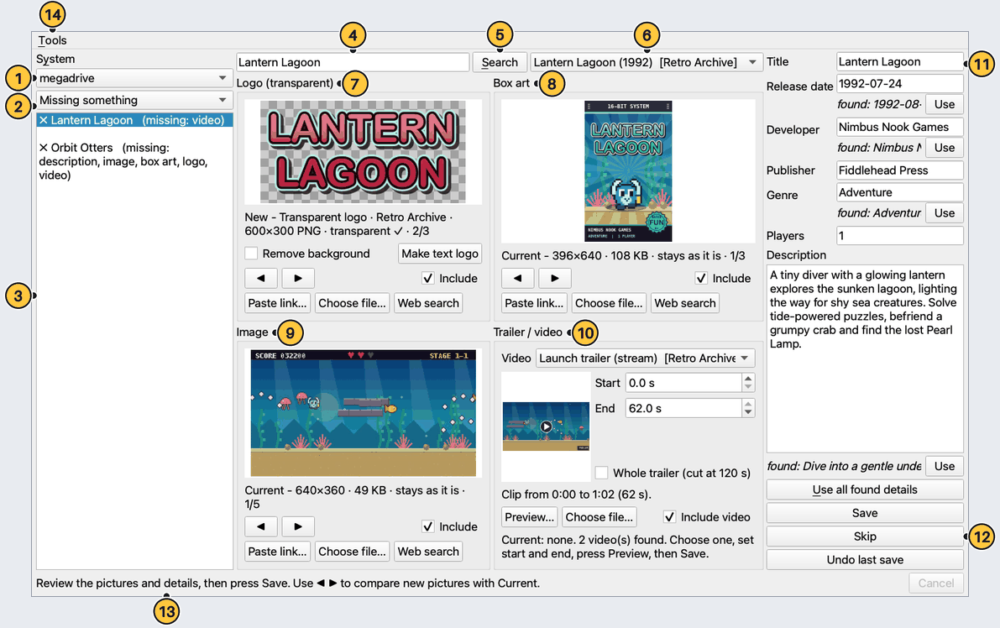</p>

| No. | Control | What it does |
|---|---|---|
| 1 | System box | The system folders under `/userdata/roms` that have games. Changing it reloads the game list. |
| 2 | Filter box | **All games**, or **Missing something** to list only games that lack a description, image, box art, logo or video. |
| 3 | Game list | One line per ROM. Click a game to load what it has now. `✓` means complete; `✗` shows what is missing. |
| 4 | Name box | The title that is searched for. It is filled from the ROM file name when you click a game; edit it freely. |
| 5 | Search button | Asks Steam and YouTube at the same time. It can take up to about a minute. |
| 6 | Match list | The games found, best first, like `Tidepool Tactics (2021)  [Steam]  100%`. Choosing another one reloads the candidates. |
| 7 | Logo (transparent) panel | The logo: a 600x300 transparent PNG. A checkerboard behind it shows what is transparent. |
| 8 | Box art panel | The box art: a 396x640 PNG. |
| 9 | Image panel | The picture: a 640x360 JPG. |
| 10 | Trailer / video panel | The trailer: an MP4 clip of the part you choose. |
| 11 | Details form | Title, release date, developer, publisher, genre, players and description, as they are in `gamelist.xml`. |
| 12 | Save, Skip and Undo last save | **Save** opens the review window. **Skip** goes to the next game without saving. **Undo last save** reverts. |
| 13 | Status line | Says what the program is doing or what went wrong. Hover over a long message to read all of it. |
| 14 | Tools menu | Installs the YouTube downloader and asks EmulationStation to reload its game lists. Each opens a progress window ([Tools menu](#tools-menu)). It is easy to miss: it is the word **Tools** in the menu bar at the top left. |

- At the right end of the status line a busy bar appears while something runs, and **Cancel** stops a search or a save that has not
  started writing files.
- A yellow note at the top of the window appears when `config.json` has a problem (see [Settings](#settings-configjson)).
- Two small buttons appear only when they are useful: **Install YouTube downloader** beside the hint line of the Trailer panel while
  the downloader is missing, and **Reload game lists** at the left of the busy bar after a save that EmulationStation did not take
  ([Tools menu](#tools-menu)).
- The first time Scrappy starts, the status line adds "Tip: the Tools menu (top left) installs the YouTube downloader and reloads
  game lists." It is shown once (setting `intro_seen`) and disappears as soon as you click a game.

> The demo's sources are made up and called "Retro Archive". On your Batocera the captions say **Steam**, **YouTube**, **you**
> (a link you pasted), **your file** or **generated**.

## Fix a game that has nothing

Use this for a game that has only its ROM file, such as `Orbit Otters (USA).md`.

1. In the **System** box choose the system, set the filter to **Missing something**, and click the game. Every picture panel says
   "Current: none".
2. Check the title in the name box. Scrappy drops tags from the file name: `Quasar Quokka (USA).sfc` becomes `Quasar Quokka`, and
   `Tidepool Tactics [0100AAAA00000000][v0].nsp` becomes `Tidepool Tactics`. Use the game's normal English name.
3. Press **Search** (or **Enter** in the name box) and wait for the status line.
4. Choose the right game in the match list. Changing it reloads the candidates and the details.
5. In each panel, step with **◀ ▶** until the picture is the one you want. A panel with nothing yet shows the first candidate.
6. Choose the trailer and its part ([Choose the part of a trailer](#choose-the-part-of-a-trailer)); check the details on the right.
7. Press **Save**, read the review window ([Save and read the review](#save-and-read-the-review)), press **Save** again.

> A search only adds candidates. A panel that already has a **Current** picture stays on it, so looking never replaces anything.

## Read a picture panel

Logo, Box art and Image panels work the same way. The picture shown is already converted, so what you see is what is saved.

<p align="center">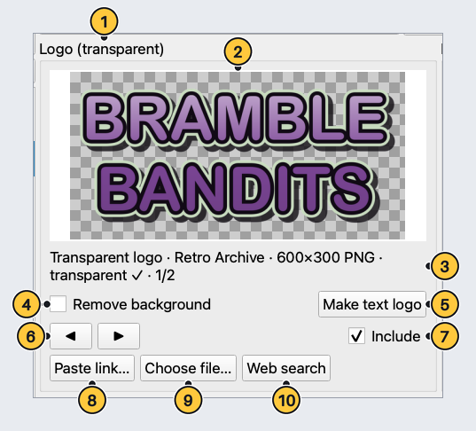</p>

| No. | Control | What it does |
|---|---|---|
| 1 | Panel title | Which file this panel makes: **Logo (transparent)**, **Box art** or **Image**. |
| 2 | Picture | The result as it will be saved. A warning line (starting with ⚠) appears above the caption when something looks off. |
| 3 | Caption | Label, source, size and position (`1/2`). `Current - ` is what the game has; `New - ` is a candidate that can be saved. |
| 4 | Remove background box | Logo panel only: makes a solid background colour transparent. Tick it when a logo comes on a plain colour. |
| 5 | Make text logo button | Logo panel only: draws a plain text logo from the title when no usable logo exists. |
| 6 | Arrow buttons | **◀ ▶** step through **Current** and the candidates, and wrap around. |
| 7 | Include box | Untick it to leave this slot alone when you save. |
| 8 | Paste link button | Adds a picture from a web address ([Use a picture or trailer of your own](#use-a-picture-or-trailer-of-your-own)). |
| 9 | Choose file button | Adds a picture file from the Batocera, a USB stick or a network share. |
| 10 | Web search button | Opens an image search for the game in a browser. |

> A slot is written only when **Include** is ticked **and** the panel shows a **New** candidate. While **Current** is showing,
> nothing is written for that slot.

## Replace only the box art

Use this for a game that has most of its files but a box art you do not like.

<p align="center">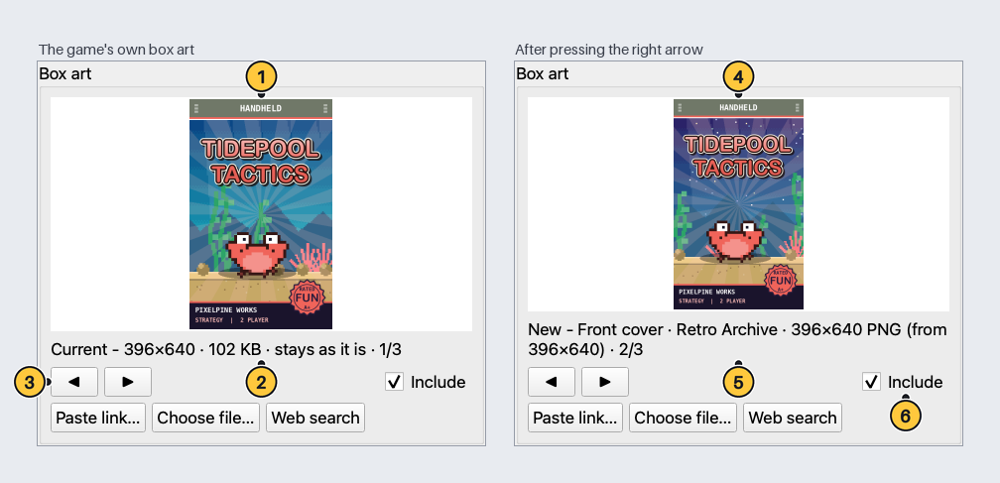</p>

| No. | Control | What it does |
|---|---|---|
| 1 | Current picture | What the game has now, read from the disk. |
| 2 | Current caption | `Current - 396×640 · 102 KB · stays as it is`: the size on disk, and nothing will be written for it. |
| 3 | Arrow buttons | Press **▶** to move from **Current** to the first new candidate. |
| 4 | New candidate | The candidate, converted exactly as it will be saved. |
| 5 | New caption | `New - ` plus the label, the source, the size and the position (`2/3`). |
| 6 | Include box | Ticked: this picture will replace the current one when you press **Save**. |

1. Click the game, press **Search**, and pick the right match.
2. In the **Box art** panel press **▶** until the caption starts with `New - `.
3. Leave the other panels on **Current**. Nothing is written for them.
4. Press **Save**. The review lists the box art as "replaces the current one" and the others under **Left as they are**.
5. Press **Save** in the review. The old file is copied to the undo journal first.

> A detail whose box is empty is filled in from the search and is written too. The **Details** table of the review window lists
> every one; press **Cancel** and clear a box to leave that detail out (an empty box never changes anything).

## Use a picture or trailer of your own

Use this for a game that is not in a scraper's database, or when you prefer your own artwork.

| Way | What to do | Limits |
|---|---|---|
| **Paste link…** | Paste the address of a picture and press OK. It is added as a candidate labelled "your link". | Starts with `http://` or `https://`, no spaces. Public sites only: addresses on your home network are refused. |
| **Choose file…** | Pick a file. The chooser starts in the home folder; browse to a USB stick or a network share. | PNG, JPG, JPEG, WEBP, BMP or GIF, up to 25 MB, a real file. |
| **Web search** | Right-click a picture in the browser that opens, choose "Copy image address", return to Scrappy, use **Paste link…**. | Needs a browser (`chrome`, then `xdg-open`). If none opens, the search address is copied for you to paste. |
| Drag and drop | Drag a picture file, or a picture's web address, onto a picture panel. | Pictures only, up to 6 items per drop. Videos cannot be dropped. |
| **Choose file…** in the trailer panel | Pick a video file from the box or a drive. | MP4, MKV, WEBM, MOV, AVI, M4V or TS, up to 4 GB. |

> Whatever you add is converted to the exact size and format like any other candidate. Pasting a link for a trailer is not
> possible yet.

## Choose the part of a trailer

The saved trailer is a clip of up to 120 seconds (the default), encoded in the format listed under [Files Scrappy writes](#files-scrappy-writes). Nothing is downloaded or encoded until you save.

<p align="center">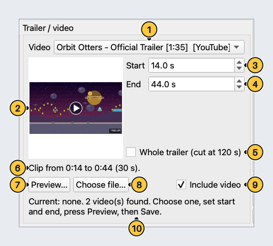</p>

| No. | Control | What it does |
|---|---|---|
| 1 | Video list | **Current video** first, when the game has one, then the Steam trailers and YouTube videos found. |
| 2 | Thumbnail | A still of the chosen video. |
| 3 | Start box | Second of the video where the clip begins. |
| 4 | End box | Second where it ends. It starts at 90 seconds, or at the video's length if that is shorter. |
| 5 | Whole trailer box | Ignores Start and End and keeps the whole video, cut at 120 seconds (`max_video_seconds`). |
| 6 | Clip summary | The result in words, for example "Clip from 0:14 to 0:44 (30 s)." |
| 7 | Preview button | Plays the chosen part in a separate player window. |
| 8 | Choose file button | Uses a video file of your own instead. |
| 9 | Include video box | Untick it to leave the trailer alone. |
| 10 | Hint line | Says how many videos were found, or "Current: none." when the game has no trailer. While the YouTube downloader is not installed, an **Install YouTube downloader** button sits beside it. |

1. Choose a video in the video list.
2. Set **Start** and **End**, or tick **Whole trailer**.
3. Press **Preview…** to check the part. Close the player window when you are done.

> **Preview…** needs a player on the Batocera: mpv, vlc or ffplay. YouTube videos need mpv and the YouTube downloader
> ([Tools menu](#tools-menu)); until it is installed the Trailer panel shows an **Install YouTube downloader** button. Without a
> player you can still choose a part and save.

## Fill in the details

The boxes show what `gamelist.xml` has now. A search never changes a box that already has text.

<p align="center">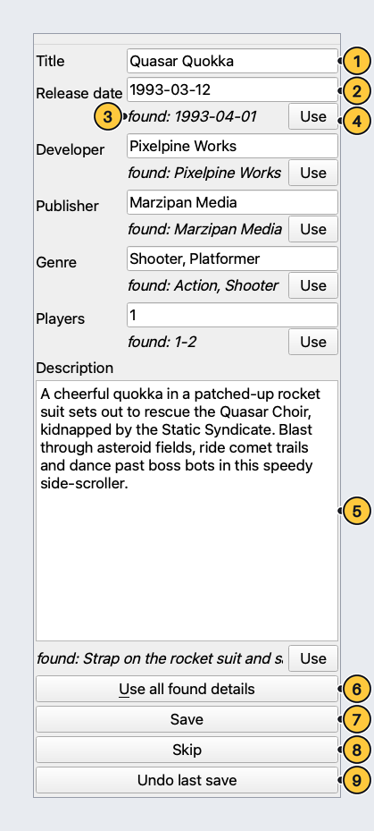</p>

| No. | Control | What it does |
|---|---|---|
| 1 | Title box | The game's name, saved to `<name>`. |
| 2 | Release date box | Type `2026-02-18`, `Feb 18, 2026` or just `2026`. A date Scrappy cannot read gets a red border and **Save** asks you to fix it. |
| 3 | Found line | `found: ...` shows what the search found when it differs from the box. Hover over it to read all of it. |
| 4 | Use button | Copies the found value into the box. Reach it with **Tab**, press it with **Space** or **Enter**. |
| 5 | Description box | The description text. Edit it freely. |
| 6 | Use all found details button | Copies every found value at once (**Alt+U**). It appears only when there is something to copy. |
| 7 | Save button | Opens the review window (**Ctrl+S**). |
| 8 | Skip button | Moves to the next game in the list without saving (**Ctrl+N**). |
| 9 | Undo last save button | Reverts the last save ([Undo](#undo)). |

- A box that is empty is filled with the found value, because that replaces nothing. It follows the match you choose until you type
  in it yourself.
- Only boxes whose text changed are written. An empty box never wipes out a value that is already in `gamelist.xml`.

> The seven text boxes are the only text Scrappy ever writes. Play count, favourite, rating and every other tag stay as they are.

## Save and read the review

Pressing **Save** opens a review window that lists exactly what will be written. Nothing is written yet.

<p align="center">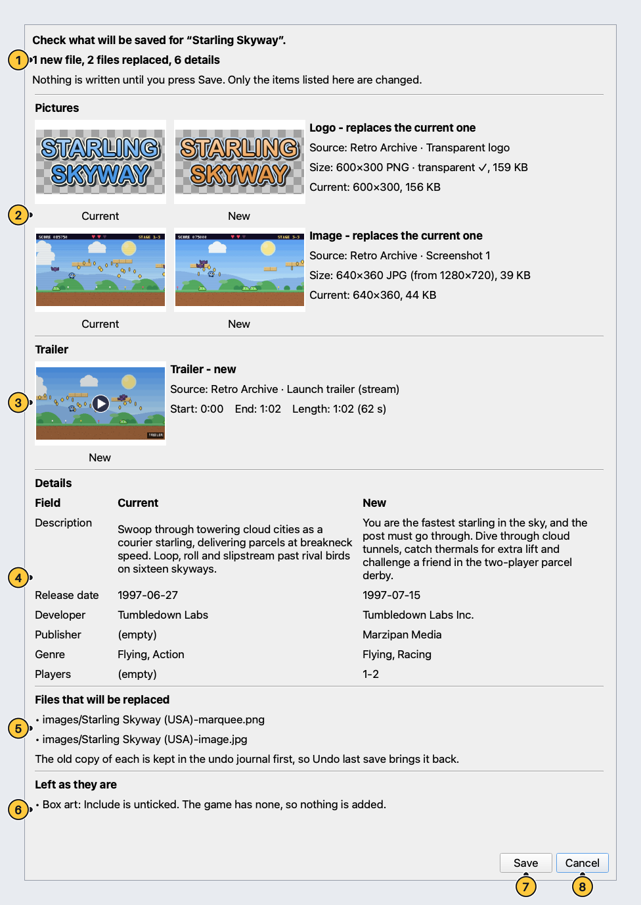</p>

| No. | Control | What it does |
|---|---|---|
| 1 | Summary line | The totals, for example "1 new file, 2 files replaced, 6 details". |
| 2 | Pictures section | Each new picture with a preview, its slot, source and size. When it replaces one, the current picture is shown beside it. |
| 3 | Trailer section | The source, the start, the end and the resulting length (and the length of the current video, if it is replaced). |
| 4 | Details table | Only the details that changed, with the current and the new value. |
| 5 | Files that will be replaced | The files that are overwritten. The old copy of each goes to the undo journal first. |
| 6 | Left as they are | Every slot that is not written, with the reason (Current showing, **Include** unticked, picture could not be loaded). |
| 7 | Save button | Writes everything listed. |
| 8 | Cancel button | Writes nothing. **Escape** does the same. |

- A **Will be linked** section can appear: files that are already on disk under Scrappy's standard name but that the game list does
  not mention. Saving only adds the entry to `gamelist.xml`.
- If nothing would be written, the window says so and offers only **Close**.
- While it works, the status line says "Preparing the video, then saving…". **Cancel** in the main window works until the files
  start to be written.
- When it is done the status line says, for example, "Saved 4 picture/video file(s); kept 0 existing. Gamelist backed up. Use Undo
  last save to revert." and the panels show what you saved as the new **Current**.

> When files will be replaced, **Cancel** is the default button, so a stray **Enter** cannot overwrite anything.

## See the result in EmulationStation

EmulationStation (ES) keeps its own copy of every `gamelist.xml`, so new art does not appear until ES reads the files again.

| Where | What to do |
|---|---|
| In Scrappy | **Tools > Reload game lists in EmulationStation**, or the **Reload game lists** button that appears next to the status line after a save ES did not take. A window shows that it is working, then either "EmulationStation reloaded its game lists." or, if it cannot reach ES, the Batocera menu path below. |
| On the Batocera | **Start > Game Settings > Update Gamelists**, or **Start > Quit > Restart EmulationStation**. |

When ES is running during a save, Scrappy looks after it for you:

1. It asks ES to reload first, so ES writes out what it had not saved yet, and waits about 2 seconds.
2. It saves.
3. It asks ES to reload again, waits about 3 seconds and checks that `gamelist.xml` still has your changes.
4. If ES wrote its older copy back, your changes are applied once more ("EmulationStation overwrote the list once; it was applied
   again."). If that fails too, the status line asks you to quit ES completely and save again.

On success the status line ends with "Game lists reloaded in EmulationStation." If ES runs but cannot be reached, you get a reminder
to restart it from its menu before making more edits, and a **Reload game lists** button appears at the left of the busy bar. It
opens the same window as the Tools entry and goes away when ES has reloaded. Scrappy never closes or restarts ES.

> If text changes vanish after an ES restart, save the game again. The files that are already there are kept and linked in again.

## Undo

Use this to put the last save back, also after you closed and reopened Scrappy.

<p align="center">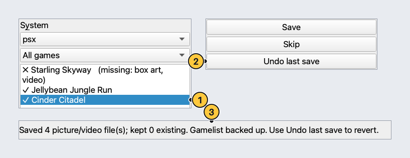</p>

| No. | Control | What it does |
|---|---|---|
| 1 | Game row with a check mark | After a save, the game shows `✓` when it now has a description, image, box art, logo and video. |
| 2 | Undo last save button | Available whenever nothing is being saved. It asks you to confirm, then reverts the last save. |
| 3 | Status line | Says what was written and how to revert it. |

1. Press **Undo last save** and confirm. The panels and boxes of the game on screen are read again.
2. `gamelist.xml` goes back as it was, the files that save created are removed, and the files it replaced come back.
3. Press it again to undo the save before that. The last 20 saves are kept.

- A file you changed yourself after the save is left alone; the status line says how many files were left.
- A save that had to be applied twice because of ES is undone in one step.

**"Undo anyway?"** appears when `gamelist.xml` is no longer the file that the save wrote, usually because ES rewrote it.

| Choice | What happens |
|---|---|
| **No** | Nothing changes. Quit or restart ES, look at the game list, and press **Undo last save** again. |
| **Yes** | The undo goes ahead. The file that is discarded is kept in that save's folder under `journal/undone/` as `gamelist.discarded-by-undo.xml`. |

> With ES running, Scrappy first asks ES to write out its changes, and that can make the file differ. This question can therefore
> appear more often than you expect. Answering **Yes** is safe.

## Clean up a whole system

Use this to fill the gaps of one system, game after game.

<p align="center">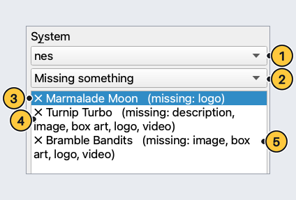</p>

| No. | Control | What it does |
|---|---|---|
| 1 | System box | Choose the system to clean up. |
| 2 | Filter box | Set it to **Missing something**. Choose **All games** to see every game, including the ones marked `✓`. |
| 3 | Selected game | Click a game to read what it has now. Hover over a line to see the ROM path. |
| 4 | Cross mark | `✗` means the game lacks something. Complete games show `✓` under **All games**. |
| 5 | Missing note | `(missing: logo, video)`. The names are description, image, box art, logo and video. |

1. Set the filter to **Missing something**. Incomplete games come first, the newest ROM files first.
2. Click a game. The files it has are shown as **Current**; the missing ones say "Current: none".
3. Search and fill the gaps with the steps of [Fix a game that has nothing](#fix-a-game-that-has-nothing). Leave panels that show
   **Current** alone.
4. Save. A game that is now complete drops out of the list. Press **Skip** (**Ctrl+N**) to go to the next game without saving.

> A game counts as complete only when its description, image, box art, logo and video are in `gamelist.xml` and the files exist and
> are not empty. Art on disk under another name that `gamelist.xml` does not mention counts as missing. If Scrappy's standard
> file name is already there, saving links it up and keeps it.

## Practise without risk

The demo opens the real window on a made-up library: 15 invented games on 5 systems, with made-up sources. It touches none of
your files.

| Where | Command |
|---|---|
| On the Batocera, over `ssh` | `ssh root@batocera.local /userdata/system/scrappy/scrappy.sh --demo` (the window appears on the box's screen) |
| In a checkout of the repository | `python -m scrappy.app --demo` |
| A real library, saved to a practice folder | `dry_run_dir` in [Settings](#settings-configjson) |

> A yellow note at the top reminds you that you are in demo mode.

## Tools menu

<p align="center">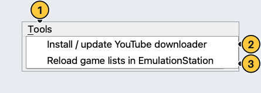</p>

| No. | Control | What it does |
|---|---|---|
| 1 | Tools menu | Opens the list below. It is in the menu bar at the top left of the window. |
| 2 | Install / update YouTube downloader | Downloads `yt-dlp` (one file, from its official GitHub releases) into `bin/`. Run it once before you use YouTube search, and again when YouTube videos stop working. A progress window shows the download and the result. |
| 3 | Reload game lists in EmulationStation | Asks ES on this machine to reload its game lists. A window shows the result. If ES cannot be reached, it tells you to use **Start > Game Settings > Update Gamelists**. |

> The installer does not include `yt-dlp` because it changes often. Search again after it is installed.

Both entries open a window in the middle of the screen and keep the main window still until you press **OK**, so you always see how
it ended. Only one such window is open at a time.

| State | What you see |
|---|---|
| Working | A blue mark, a line saying what is going on, and a progress bar. The bar fills with a percentage and "x of y MB" while a download runs; it moves back and forth while the size is unknown or a quiet step runs. **Cancel** is there when stopping is safe (the download). |
| Done | A green check mark, one sentence about what was done and the lines that matter (the version, the file). The window stays until you press **OK**. |
| Failed | A red cross, the reason in plain words, what to try, and a **Details** button that opens the technical text (send it when asking for help). The button at the bottom says **Close**. |
| Cancelled | A grey mark and one sentence saying that nothing was changed. |

> Pressing **Esc** or the window's close button while it works is the same as **Cancel**, and the window closes by itself once
> the download has stopped. The reload cannot be stopped half way (it takes a few seconds at most), so its window waits.

### Install or update the YouTube downloader

While the download runs:

<p align="center">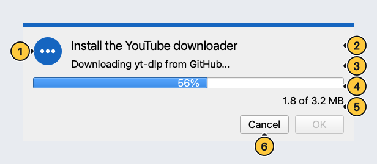</p>

| No. | Control | What it does |
|---|---|---|
| 1 | State mark | Blue while it works. It turns into a check mark or a cross when it is over. |
| 2 | Title | What is being done: "Install the YouTube downloader", or "Update the YouTube downloader" when one is installed already. |
| 3 | Message | The step in plain words: connecting, downloading, checking the file, testing that it starts, installing. |
| 4 | Progress bar | Fills as the file arrives, with the percentage inside it. |
| 5 | Size line | Megabytes so far and the total GitHub announced, for example "1.8 of 3.2 MB". If GitHub does not announce a size it says "1.8 MB downloaded" and the bar keeps moving. |
| 6 | Cancel button | Stops the download. Nothing is installed, no half-downloaded file is left, and a downloader you already had is not touched. |

When it has finished:

<p align="center">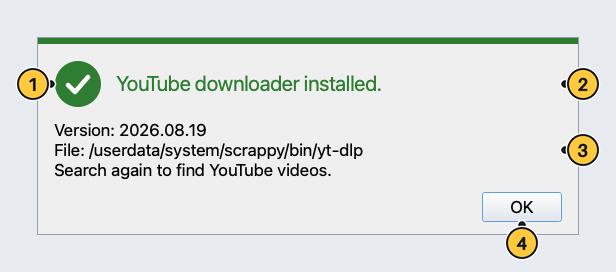</p>

| No. | Control | What it does |
|---|---|---|
| 1 | Check mark | Green: it worked. |
| 2 | Result | "YouTube downloader installed.", "YouTube downloader updated." or "YouTube downloader is up to date." |
| 3 | What was done, and where | The version (for an update: "Updated from version A to B."), the file, and a reminder to search again. |
| 4 | OK button | Closes the window. The status line keeps a short version of the result. |

If it did not work:

<p align="center">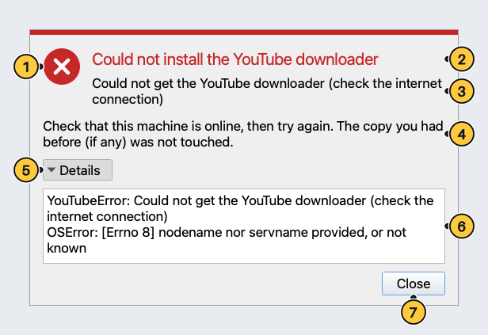</p>

| No. | Control | What it does |
|---|---|---|
| 1 | Cross | Red: it did not work. Nothing was installed or changed. |
| 2 | What failed | "Could not install the YouTube downloader" (or "update"). |
| 3 | The reason | In plain words, for example no internet connection, GitHub answering from an unexpected address, a file that is not the downloader, or a folder that cannot be written. |
| 4 | What to try | Check that the machine is online and try again. The copy you had before, if any, was not touched. |
| 5 | Details button | Shows or hides the technical text. |
| 6 | Technical details | The error and what lay behind it, as the program saw it. It is also in `logs/scrappy.log`. |
| 7 | Close button | Closes the window. |

The same window opens from **Tools > Install / update YouTube downloader** and from the **Install YouTube downloader** button in the
Trailer panel. That button is there only while `bin/yt-dlp` is missing, and goes away when the install worked.

### Reload game lists in EmulationStation

The window shows a moving bar for a moment, then one of two results:

| Result | What it says | What to do |
|---|---|---|
| Done | "EmulationStation reloaded its game lists." The status line says the same. | Nothing: look at the game in ES. |
| Not reached | "Could not reach EmulationStation, so its game lists were not reloaded." and "Do it by hand: Start > Game Settings > Update Gamelists." The status line keeps that sentence too. | ES is probably not running on this machine. Use the Batocera menu path. |

The same window opens from the **Reload game lists** button that appears next to the status line after a save ES did not take.

## Files Scrappy writes

Names follow the ROM file name without its extension, the same rule Batocera's scraper follows. For a game
`Tidepool Tactics [0100AAAA00000000][v0].nsp` in `/userdata/roms/switch`:

| Slot | Folder | File name | Format and size | `gamelist.xml` tag |
|---|---|---|---|---|
| Image | `images/` | `<ROM name>-image.jpg` | JPG, 640x360 | `<image>` |
| Box art | `images/` | `<ROM name>-thumb.png` | PNG, 396x640 | `<thumbnail>` |
| Logo | `images/` | `<ROM name>-marquee.png` | PNG, 600x300, transparent | `<marquee>` |
| Trailer | `videos/` | `<ROM name>-video.mp4` | MP4, H.264, 1280x720, 30 fps, about 1.5 Mbps, with sound | `<video>` |

- The folders are inside the system folder (here `/userdata/roms/switch/images/`). They are created if they do not exist.
- The tags hold paths like `./images/<ROM name>-image.jpg`. A ROM in a sub-folder still gets its files in `images/` and `videos/`.
- The sizes and formats are fixed in the program. It does not read your theme.

The text boxes go to these tags:

| Box | Tag |
|---|---|
| Title | `<name>` |
| Description | `<desc>` |
| Release date | `<releasedate>`, written as `20260218T000000` |
| Developer | `<developer>` |
| Publisher | `<publisher>` |
| Genre | `<genre>` |
| Players | `<players>` |

- If the game is not in `gamelist.xml` yet, a `<game>` entry with its `<path>` is created.
- The game also gets a `<scrap>` marker (`name="Scrappy"` and the date) so you can see what the program touched.
- Nothing else changes: play count, last played, favourite, hidden, rating, md5, language and unknown tags stay as they are, and other
  games are not touched.
- The file is rewritten as a whole, safely, through a temporary file. Small formatting differences can appear, and XML comments are
  lost ([KNOWN-LIMITATIONS.md](KNOWN-LIMITATIONS.md)).

> **Existing art is respected.** Scrappy reads what a game has from the file its tag points to, or else from the standard name.
> It replaces a slot only when you chose a new candidate and confirmed. If the replaced file has another name, the new file is
> written under the standard name, the tag points to it, and the old file stays on disk untouched.

## The program's own folder

Everything Scrappy keeps is in `/userdata/system/scrappy/`.

| Folder or file | What it holds | Space |
|---|---|---|
| `scrappy/`, `tools/`, `vendor/`, `scrappy.sh`, `icon.png` | The program. | A few MB |
| `config.json` | Your settings (optional). Scrappy adds `intro_seen` itself after its first start. | Tiny |
| `backups/` | Copies of `gamelist.xml` taken before saving: the first one per system is kept forever (`...-original.xml`), plus the newest 30. | About the size of your game lists |
| `journal/` | One folder per save: the exact "before" copy of `gamelist.xml`, the list of created files, and copies of replaced files. The newest 20 saves and 20 undone saves (`journal/undone/`) are kept. | Small, unless you replace trailers: each is about 10-15 MB, so a few hundred MB at most |
| `cache/` | Downloaded pictures, trimmed to about 200 MB. | Up to about 200 MB |
| `tmp/` | Trailers just encoded and downloads in progress. Leftovers older than 24 hours are removed at start. | A few clips of 10-15 MB |
| `bin/yt-dlp` | The YouTube downloader ([Tools menu](#tools-menu)). | About 3 MB |
| `logs/scrappy.log` | The program's log ([Logs](#logs)). | Up to about 1.5 MB |

> The installer refuses to install with less than 200 MB free on `/userdata`. The new pictures and videos themselves go to the ROM
> drive, next to the ROMs.

## Settings (`config.json`)

The file is optional: `/userdata/system/scrappy/config.json`, a JSON object made with any text editor. Restart Scrappy after
changing it. The program writes this file in one case only: after the first start it sets `intro_seen` to `true` (see below). It
keeps every other line as it is, and it does not touch a file that has a problem.

| Key | Default | Range | Meaning |
|---|---|---|---|
| `roms_root` | `"/userdata/roms"` | A full path starting with `/` | The folder that holds one sub-folder per system. |
| `data_dir` | `"/userdata/system/scrappy"` | A full path starting with `/` | Where backups, journal, cache, tmp, bin and logs live. `config.json` is always read from the default location. |
| `max_video_seconds` | `120` | 1 to 600 | Longest trailer clip ever encoded, in seconds. Longer choices are cut. |
| `default_video_seconds` | `90` | 1 to 600, never above `max_video_seconds` | Where the **End** box starts. |
| `video_bitrate` | `"1500k"` | Like `"1500k"` or `"2M"` | Video quality target for the trailer encode. The encoder caps the rate at 2200k, so more gives no extra quality. |
| `search_timeout` | `20` | 0.1 to 300 | Seconds to wait for the game sources (Steam). |
| `youtube_search_timeout` | `45` | 0.1 to 600 | Seconds to wait for the YouTube search, which starts slowly on the box. |
| `dry_run_dir` | `null` | A full path, or `null` | When set, saves go to a practice copy there instead of your library (below). |
| `intro_seen` | `false` | `true` or `false` | Scrappy sets it to `true` once the status line has shown the tip about the Tools menu. Set it to `true` yourself to never see the tip, or remove the line to see it again. |

```json
{
  "max_video_seconds": 90,
  "default_video_seconds": 60,
  "youtube_search_timeout": 60
}
```

- A missing, unreadable or broken file gives the defaults. A wrong value falls back to that one default. Either way a yellow note
  at the top of the window says what was wrong.
- Names Scrappy does not know are ignored without a message, so a typo is silently ignored.
- Names containing "key", "token", "secret", "passw" or "credential" are never loaded: passwords do not belong in this file.

### Dry-run mode

1. Add `"dry_run_dir": "/userdata/system/scrappy-dry-run"` (any full path outside your system folders).
2. Restart Scrappy. Search, downloads, conversion and the review work as normal.
3. **Save** writes only into the practice folder: a copy of the game's `gamelist.xml` and media, with its own backups and journal.
4. The status line says "Dry run: nothing was written to the real folders". **Undo last save** undoes the practice save.
5. Remove the line (or set it to `null`) and restart to go back to real saves.

> The real files do not change in a dry run, so the game stays marked as missing in the list.

## Keyboard and mouse

| Keys or mouse | What it does |
|---|---|
| **Ctrl+S** | Save (opens the review window). |
| **Ctrl+F** | Jump to the name box. |
| **Ctrl+N** | Next game, the same as **Skip**. |
| **Enter** in the name box | Search. |
| **Alt+S**, **Alt+Y**, **Alt+U** | **Search**, the **System** box, **Use all found details**. |
| **Tab**, **Shift+Tab** | Move between controls. **Space** or **Enter** presses the one in focus (for example a **Use** button). |
| **Up**, **Down** in the game list | Move to the previous or next game. **Enter** on a game jumps to the name box. |
| **Escape** in the review window | Cancel. |
| Drag a picture or a picture link onto a panel | Adds it as a candidate. |
| Hover over a game, a caption or the status line | Shows the ROM path, the file path of the current picture, or the whole message. |

There is no special gamepad mode. Use a keyboard and mouse, or a gamepad if your desktop lets it move the mouse.

## Troubleshooting

| Symptom | Likely cause | What to do |
|---|---|---|
| "No matching game found" or "Nothing found" | Misspelled title, extra words, or a game Steam does not sell. | Use the plain English name without "Deluxe" or a region. For older console games use **Choose file…** and **Paste link…**. |
| One source reports a problem while the other works | Steam "did not answer in time". One source never blocks the other. | Try again in a minute, or raise `search_timeout`. |
| Search, YouTube or link pasting fail | No internet on the Batocera. | Check its network settings (or `ping 8.8.8.8` over `ssh`). **Choose file…** and your own text still work. |
| YouTube videos do not appear, or "The YouTube downloader is not installed yet" | No `yt-dlp`, or it is out of date. | **Tools > Install / update YouTube downloader**, then search again. It needs the box's Python 3.10 or newer. |
| The **Search** button is greyed out | No game is chosen, or a search is already running. | Click a game in the list, or wait for the search to end (or press **Cancel**). |
| Preview stops at once | The player exited with an error. | The status line shows its last error line; the same line is in `logs/scrappy.log`. Send it when asking for help. |
| Preview does nothing, or "no video player was found" | No mpv, vlc or ffplay. | You can still choose a part and save. YouTube previews need mpv and the downloader. |
| Preview window is black | The video is streamed from the internet. | Wait a few seconds, press **Preview…** again, or choose another video. The saved clip is made by ffmpeg and is not affected. |
| Where do I install the YouTube downloader or reload the game lists? | Both are under **Tools** in the menu bar at the top left (words only, no icon). | Use that menu, or the **Install YouTube downloader** button in the Trailer panel, or the **Reload game lists** button next to the status line (each shows up when it is needed). |
| The progress window says "Could not install the YouTube downloader" | No internet on the Batocera, GitHub not reachable, a wrong answer from the web, or a folder that cannot be written. | Read the reason, press **Details** for the technical text, fix the cause and try again. Nothing was installed and an older copy was not touched. |
| The progress window says "Cancelling…" for a long time | The download is waiting for GitHub, which has gone silent. | It stops within about a minute. Press **Esc** or the close button again to leave at once; nothing is installed. |
| The reload window says "EmulationStation was not reached" | ES is not running on this machine, or it did not accept the request. | **Start > Game Settings > Update Gamelists** in the Batocera menu. |
| "JPEG" or "Pillow" errors ("Wrong JPEG library version") | The box's own Pillow cannot read or write JPEG. | Start Scrappy with its launcher (`scrappy.sh`, used by the menu entry and the icon), or run the installer again if `vendor/` is missing. |
| Wrong title or description | The title came from the file name, or the wrong match is chosen. | Edit the name box and search again, choose another match, or type the text yourself. |
| "Could not use this one" under a picture | Not a picture, too big, or a blocked address. | Press **▶** for the next candidate, or use **Paste link…** or **Choose file…**. |
| A warning above a logo | The logo has a solid background. | Tick **Remove background**, pick another candidate, or press **Make text logo**. |
| "cropped from a wide picture" under box art | A wide picture was cut to the portrait shape. | Pick another candidate or supply a better file. |
| Release date has a red border | Scrappy cannot read the date. | Type `2026-02-18`, `Feb 18, 2026` or `2026`, or clear the box. |
| "Save failed … Nothing was changed." | Disk full, no permission, read-only drive, damaged `gamelist.xml`, or ES kept rewriting it. | A failed save is rolled back completely. Read the cause, quit or restart ES if it is the cause, and save again. A damaged `gamelist.xml` is never touched; older copies are in `backups/`. |
| New art does not show in the game list | ES has the old lists in memory, or it overwrote `gamelist.xml`. | Reload the lists ([See the result in EmulationStation](#see-the-result-in-emulationstation)); if it still does not show, save the game again. |
| The window closed, or something odd happened | An unexpected error. | Read the log ([Logs](#logs)). Unexpected errors are shown in the status line and Scrappy keeps running where it can. |

## Logs

| File | What it holds | Size |
|---|---|---|
| `/userdata/system/logs/scrappy.log` | Everything the program prints, from the launcher. | A new file starts at about 1 MB; three older ones are kept (`.1`, `.2`, `.3`). |
| `/userdata/system/scrappy/logs/scrappy.log` | The program's own log. | About 500 KB, two older copies. |

Look at the end of the log over `ssh`: `ssh root@batocera.local tail -n 80 /userdata/system/logs/scrappy.log`.

## Update, reinstall, uninstall

All installer commands run **on the computer you install from** (a Mac or a Linux machine), in a checkout of this repository.
It needs `ssh` access to the Batocera without a password prompt (an `ssh` key), and internet access the first time to fetch the
Pillow file (checked against a fixed checksum, kept in `~/.cache/scrappy/wheels`). The
[README](../README.md#install-on-batocera) says what the installer does and checks.

```
deploy/install.sh --dry-run                 # show every step, change nothing on the Batocera
deploy/install.sh                           # install or update on root@batocera.local
deploy/install.sh root@192.168.1.100        # another address
deploy/install.sh --uninstall --dry-run     # show what removing would do
deploy/install.sh --uninstall               # remove the program and its shortcuts, KEEP your data
deploy/install.sh --uninstall --purge --yes # remove everything, including backups/ and journal/ (and so Undo)
```

- Updating and reinstalling are the same command. The new version is staged and tested on the box before it replaces the old one;
  the old one is kept as `scrappy.previous`, `tools.previous` and `vendor.previous`.
- An install or update never touches `config.json`, `backups/`, `journal/`, `cache/`, `bin/` or `logs/`.
- The installer asks the machine for its architecture (`uname -m`) and accepts **x86_64** and **aarch64**. Anything else is refused
  before anything is built or sent.
- A `--dry-run` makes no connection to the Batocera, so it assumes `x86_64`, or the value of `SCRAPPY_ARCH` (`x86_64`, `aarch64` or
  `arm64`), and says so: `SCRAPPY_ARCH=aarch64 deploy/install.sh --dry-run root@192.168.1.100`. A real install ignores `SCRAPPY_ARCH`.
- A dry run still builds the package in a temporary folder on your computer and fetches the Pillow file if it is not cached yet.
- To see which version is installed: `ssh root@batocera.local cat /userdata/system/scrappy/VERSION`.
- An install made by a pre-release version under the name game-asset-fixer is migrated automatically by the installer (settings, backups, undo history and cache are moved; the old folder is kept as a timestamped backup). `--uninstall` does not touch that backup folder.

## What is not here yet

- Sources other than Steam and YouTube (no Wikipedia, no SteamGridDB, no IGDB). Games that Steam does not know need your own files.
- A search for pictures inside the program. **Web search** opens a browser and you copy the address back.
- Pasting a link for a trailer, or dropping a video file on the window (use **Choose file…**). Dropping pictures and picture links
  works.
- A queue for doing many games at once.
- Any change to the ROMs themselves, or to ScreenScraper settings or logins (the program never reads them).

[ROADMAP.md](../ROADMAP.md) lists what might come next and what is not planned.

Developers: how these annotated pictures are made is in [CONTRIBUTING.md](../CONTRIBUTING.md#screenshots).
